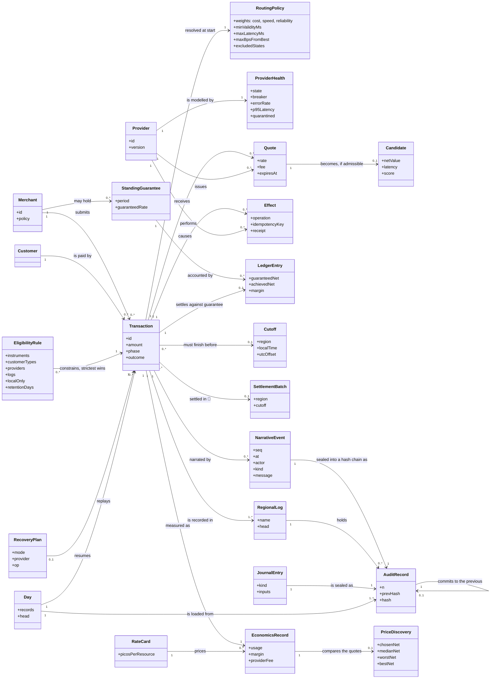

# 02 · Domain model (Larman style)

A conceptual model of the problem domain: the things the business talks about, not
software classes. Entities marked 🔲 are planned (only `SettlementBatch` remains).

## Glossary

| Term | Meaning |
|---|---|
| **Transaction** | One FX swap and payment for a customer, owned by exactly one process for its whole life. |
| **Provider** | A third-party service (FX quote + payment) we do not control. Facaded by an adapter. |
| **Quote** | A firm offer with an expiry: rate and fee. |
| **Candidate** | A quote that passed constraints, with net value, latency and score. |
| **Net value** | `amount × rate − fee`: what the customer ends up with, in integer minor units. |
| **Minor unit** | The smallest currency unit (a cent). All amounts and fees are whole minor units; no floats hold money. |
| **Scaled rate** | A rate as an integer times 10^8 (`1.0820` is `108_200_000`). Decimal input is converted exactly; rounding is half-even. |
| **Audit record / chain** | One event sealed with the hash of the record before it; editing, removing or reordering any record breaks the chain at that point. |
| **Head** | The count and hash of the last audit record. Stored independently, it also exposes truncation of the tail. |
| **Price discovery** | How the quote we took compares with all quotes received: chosen, median, worst and best net. |
| **Saved vs median / worst** | Net obtained minus the median / worst quote: what routing earned over an unoptimised pick. |
| **Regret vs best** | Best quote minus net obtained: the price of non-price goals such as speed and reliability. |
| **Journal** | The machine-replayable part of the log: every input from the outside world and the context to re-judge every decision. |
| **Replay** | Loading a day from its log to query its state, verify its rules, compare it or re-judge it under a different policy. |
| **Day** | A loaded log: its records in order, grouped by transaction. |
| **What-if** | Re-judging the recorded provider answers under a changed policy to see what the change alone would have done on that day. |
| **Corridor** | The origin and destination regions of a transaction; the rules of both apply, the strictest wins. |
| **Eligibility** | Hard constraints from jurisdiction (providers, instruments, customer types, logs, retention), applied before scoring. |
| **Local-only region** | A region whose transactions are recorded only in its own log, not in the global one. |
| **Regional log** | One independently verifiable audit log per named region. |
| **Write-ahead** | The record of a call is on disk before the call is made; after a crash the log never misses a call that was sent. |
| **Barrier** | The wait that makes every durable sink write everything emitted so far; called before each money-moving call. |
| **Fail closed** | If the durable log is unavailable, no money moves. |
| **Recovery plan** | Where an open transaction stood, rebuilt from its log: fresh, next, doubt, undo, complete or review. |
| **Rate card** | The explicit prices that turn measured usage (CPU, memory, network, storage, provider calls) into cost. |
| **Pico-unit** | 10^-12 of a major currency unit; the unit of cost, since one transaction costs a fraction of a cent. |
| **Effect** | Something that actually happened at a provider: accept, authorise, pay (or an undo). |
| **Idempotency key** | `"<tx>:<provider>:<step>"`. Reused on retry so a repeat cannot repeat the effect. |
| **Undo** | `cancel_accept`, `void_authorisation`, `refund`: compensating operations keyed by the effect's key. |
| **In doubt** | We asked, got no definite answer; the effect may or may not have happened. |
| **Reconcile** | Ask the provider (`status`) what it holds for a key. |
| **Needs review** | A state we refuse to resolve by guessing; a human decides. |
| **Cut-off** | The latest moment (regional local time) by which a payment must be made and settled. |
| **Standing guarantee** | A rate a merchant is guaranteed for a period; the gap to what we achieve is margin or exposure. |
| **Settlement** | The final step after payment; has no undo, so failure escalates. |
| **Baseline** | A valid default route returned when no quote is usable. |
| **Health state** | `unknown / healthy / degraded / stalled / quarantined`: our view of a provider. |
| **Breaker** | Per-provider circuit: `closed / open / half_open`. |
| **Quarantine** | A provider whose version changed is not trusted until released. |
| **Narrative** | The ordered stream of events describing everything the system does. |
| **Batch** | A run of many transactions sent by Bulk send: a count, an amount range, a pause, and fixed or randomised settings. |
| **Plan** | The validated description of a batch; a seeded plan generates the same transactions every time. |
| **Seed** | A whole number that makes a random batch repeatable. |
| **Test lab** | The dashboard tab (`mix demo --lab`) for provoking and judging restarts, idempotency, the router and audit-log downtime. |
| **Scenario** | A named situation in the Test lab with an expected outcome and hard checks (17 exist). |
| **Fault mode** | The state the lab puts the durable log in: healthy, down, or failing after N steps. |
| **Armed crash** | A request to kill the next transaction the moment a given event happens, as a node dying at that instant would. |
| **Code-shape limit** | A numeric limit on function complexity, nesting, size and duplication, enforced in CI (ADR 0012). |

## Operation contracts (key system operations)

**`submit(request, providers, policy, opts)`**

* *Pre:* `request.amount` present; `request.id` contains no `:`; providers and policy supplied.
* *Post:* a transaction process exists for `id` (or already existed); a `tx_received` event was emitted; returns `{:ok, id}`.

**`select(request, providers, policy, deadline)`**

* *Pre:* policy valid.
* *Post:* every provider is either skipped (state excluded), called, or reported failed; candidates satisfy all hard constraints and `max_bps_from_best`; ranking is deterministic (score desc, provider id asc); returns within `deadline + grace`.

**`step(op, key)`** (accept, authorise, pay)

* *Pre:* previous step succeeded at the same provider; quote not expired.
* *Post:* the effect has happened at most once for `key`; outcome is `ok`, definite failure, or doubt; doubt is never treated as failure for `pay`.

**`compensate(done_steps)`**

* *Post:* each completed step has its undo issued in reverse order, or the transaction is in `needs_review`.

**`record(event)`** (audit)

* *Pre:* the audit log verifies (or is empty).
* *Post:* exactly one new line exists whose `n` is the previous `n + 1`, whose `prev` is the previous hash and whose hash covers its body; free-text fields contain no Luhn-valid card number; on a synced log the line is durable before the call returns.

**`verify(path)`**

* *Post:* returns the record count and head hash if every sequence number, link and hash holds; otherwise the first failing line and the reason (`malformed`, `out_of_sequence`, `chain_broken`, `hash_mismatch`). Never modifies the log.

**`price(usage)`** (economics)

* *Post:* each resource cost is an integer number of pico-units computed from the rate card with half-even rounding; the total is the sum of the parts; value (saved, margin) is kept separately in minor units and never mixed with cost until the net is formed.

**`evaluate(request, observations, policy)`** (selection, pure)

* *Pre:* each observation names a provider, its health state, what it answered, the latency and when it was seen.
* *Post:* returns the per-provider judgements, the admissible candidates ranked best first (score descending, provider id ascending) and the excluded with reasons. No process, clock or event is touched, so the live system and replay get the same answer from the same inputs.

**`state_at(day, point)`** (replay)

* *Post:* only records up to and including `point` are folded; returns each transaction's summary as of then, who is in flight, provider health and last price, the policy in force and the operator actions so far.

**`what_if(day, overrides)`** (replay)

* *Pre:* overrides form a valid policy change.
* *Post:* every transaction with recorded quotes is re-judged under the recorded policy and under the changed one; the totals say how many would route differently and what that is worth in net and latency, on quote values.

**`barrier()`** (write-ahead)

* *Post:* returns `:ok` only if every registered durable sink has written every event emitted before the call; otherwise an error naming the failed or unresponsive sink. `Payment` does not make a money-moving call unless it returned `:ok`.

**`decide(eligibility, request)`**

* *Post:* `permitted?` is true only if every region involved allows the instrument and the customer type; the allowed-provider test is the conjunction of every region's provider rule; `logs` is the union of the involved regions' logs, or only the local-only regions' logs if any is involved; `retention_days` is the longest that applies.

**`plan(records)`** (recovery, pure)

* *Post:* `nil` if the transaction never started; `done` if it has a terminal record; otherwise a mode saying what to do next. A step with a recorded start and no recorded answer is `doubt`, never `next`.

**`recover(days, opts)`**

* *Post:* for each open transaction found (once, however many logs hold it) a resumed `Payment` is started, or an error is returned for it; the money rules of `Payment` apply unchanged.
