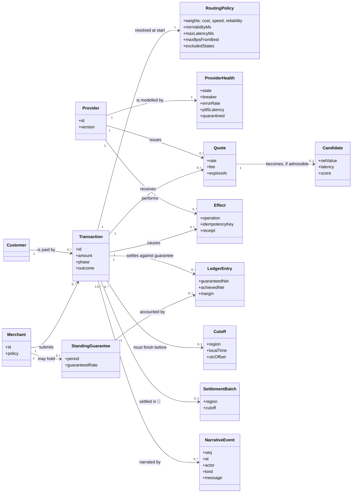

# 02 · Domain model (Larman style)

A conceptual model of the problem domain: the things the business talks about, not
software classes. Entities marked 🔲 are planned (only `SettlementBatch` remains).

## Glossary

| Term | Meaning |
|---|---|
| **Transaction** | One FX swap and payment for a customer, owned by exactly one process for its whole life. |
| **Provider** | A third-party service (FX quote + payment) we do not control. Facaded by an adapter. |
| **Quote** | A firm offer with an expiry: rate and fee. |
| **Candidate** | A quote that passed constraints, with net value, latency and score. |
| **Net value** | `amount × rate − fee`: what the customer ends up with. |
| **Effect** | Something that actually happened at a provider: accept, authorise, pay (or an undo). |
| **Idempotency key** | `"<tx>:<provider>:<step>"`. Reused on retry so a repeat cannot repeat the effect. |
| **Undo** | `cancel_accept`, `void_authorisation`, `refund`: compensating operations keyed by the effect's key. |
| **In doubt** | We asked, got no definite answer; the effect may or may not have happened. |
| **Reconcile** | Ask the provider (`status`) what it holds for a key. |
| **Needs review** | A state we refuse to resolve by guessing; a human decides. |
| **Cut-off** | The latest moment (regional local time) by which a payment must be made and settled. |
| **Standing guarantee** | A rate a merchant is guaranteed for a period; the gap to what we achieve is margin or exposure. |
| **Settlement** | The final step after payment; has no undo, so failure escalates. |
| **Baseline** | A valid default route returned when no quote is usable. |
| **Health state** | `unknown / healthy / degraded / stalled / quarantined`: our view of a provider. |
| **Breaker** | Per-provider circuit: `closed / open / half_open`. |
| **Quarantine** | A provider whose version changed is not trusted until released. |
| **Narrative** | The ordered stream of events describing everything the system does. |

## Operation contracts (key system operations)

**`submit(request, providers, policy, opts)`**

* *Pre:* `request.amount` present; `request.id` contains no `:`; providers and policy supplied.
* *Post:* a transaction process exists for `id` (or already existed); a `tx_received` event was emitted; returns `{:ok, id}`.

**`select(request, providers, policy, deadline)`**

* *Pre:* policy valid.
* *Post:* every provider is either skipped (state excluded), called, or reported failed; candidates satisfy all hard constraints and `max_bps_from_best`; ranking is deterministic (score desc, provider id asc); returns within `deadline + grace`.

**`step(op, key)`** (accept, authorise, pay)

* *Pre:* previous step succeeded at the same provider; quote not expired.
* *Post:* the effect has happened at most once for `key`; outcome is `ok`, definite failure, or doubt; doubt is never treated as failure for `pay`.

**`compensate(done_steps)`**

* *Post:* each completed step has its undo issued in reverse order, or the transaction is in `needs_review`.
