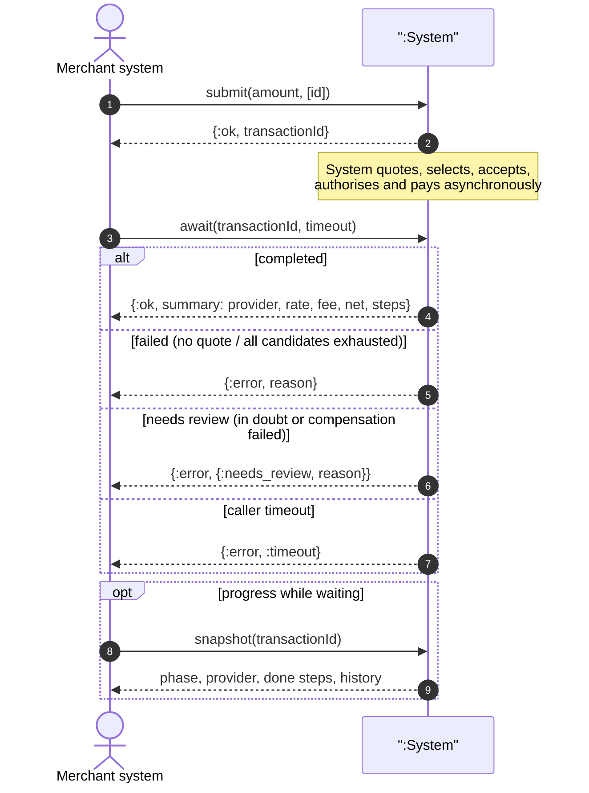
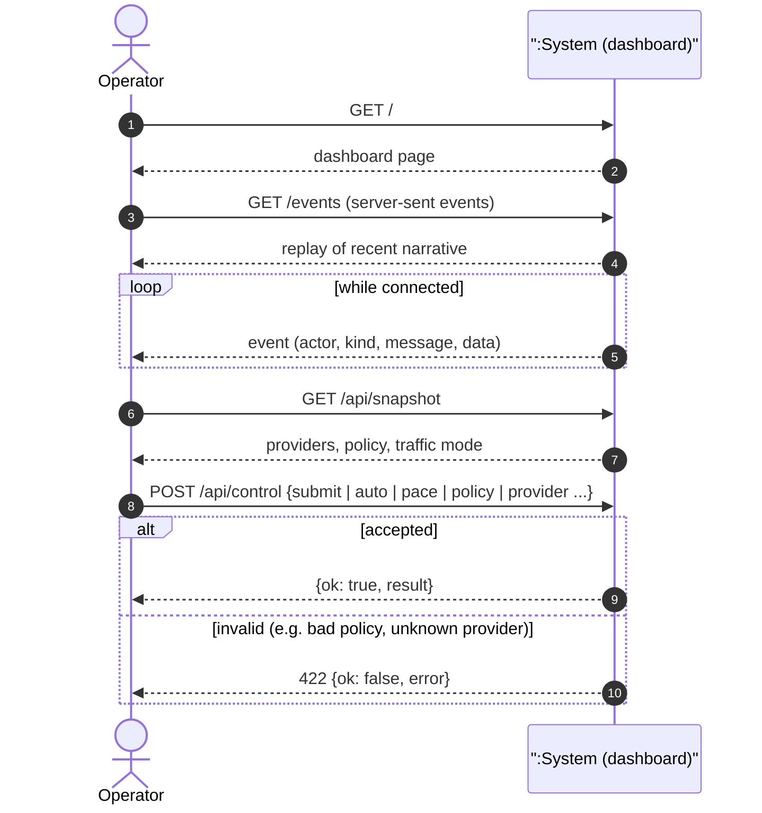
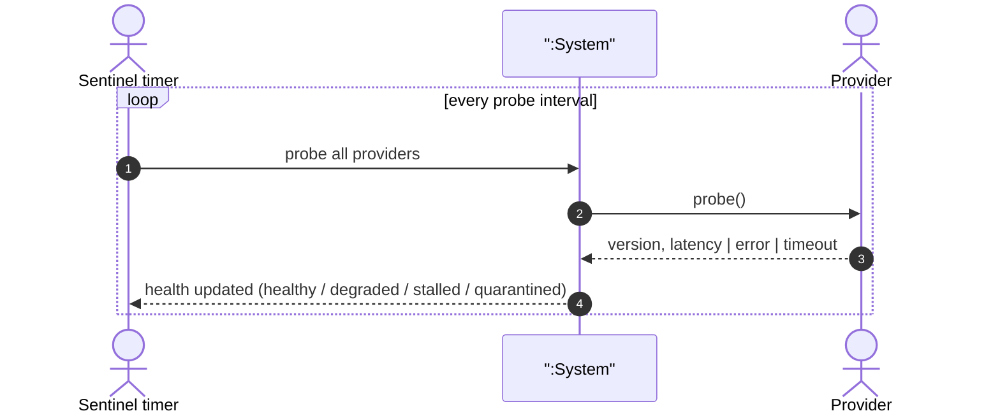

# 03 · System sequence diagrams (Larman style)

The system is a single black box (`:System`). Only the actors' requests and the
system's responses are shown; internals are in [04](04-design-sequences-and-activities.md).

## SSD-1 · Complete an FX swap and payment (UC-1)

## SSD-2 · Observe and operate (UC-2, UC-5)

## SSD-3 · Keep provider knowledge honest (UC-3)

