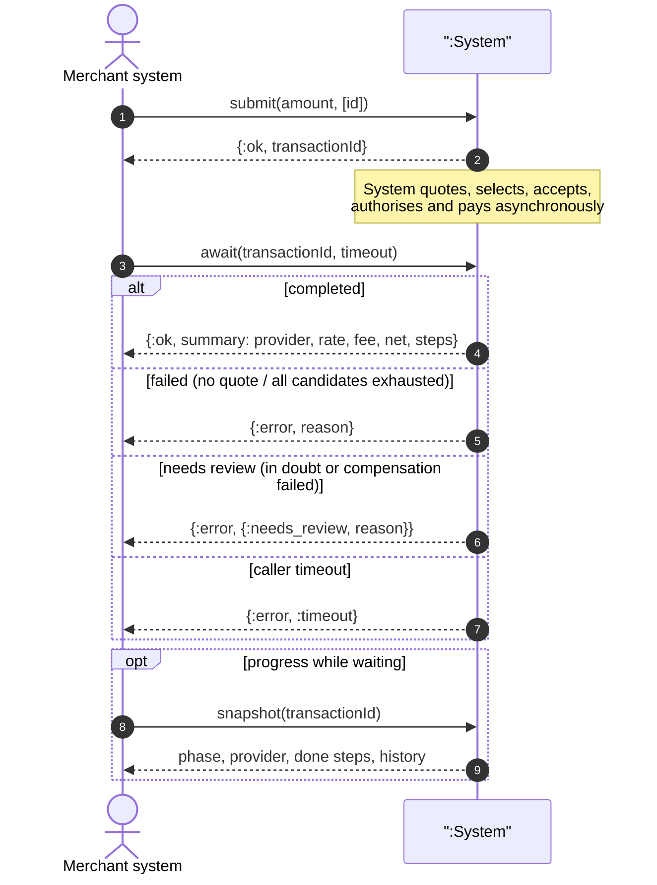
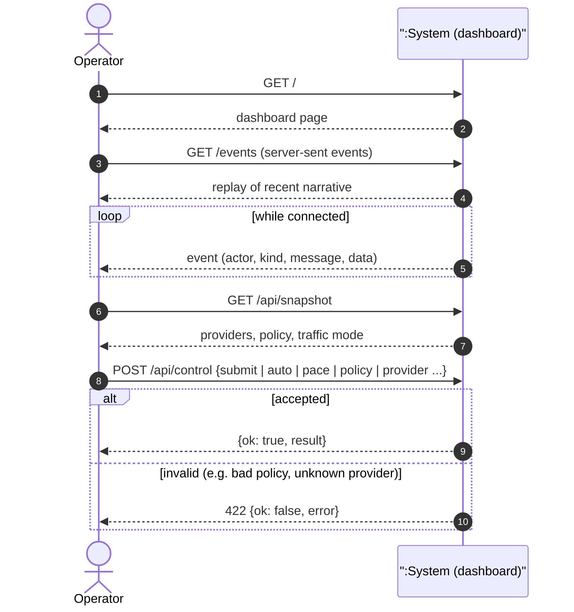
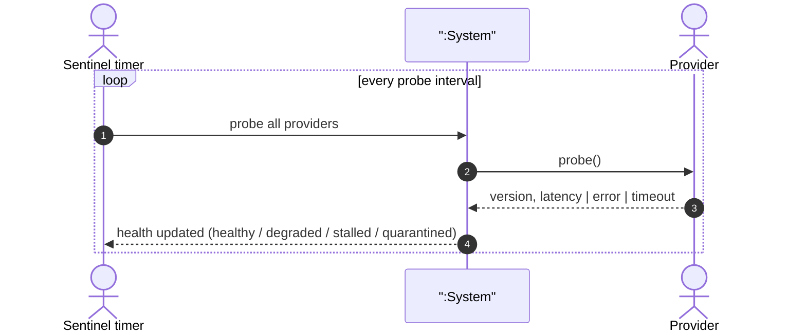
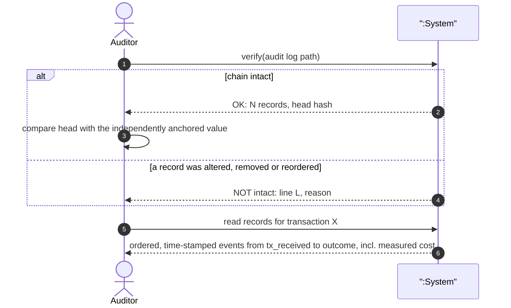
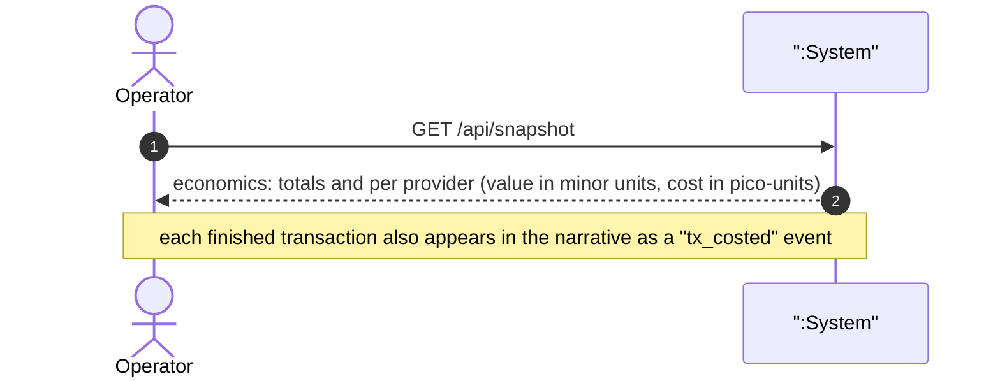
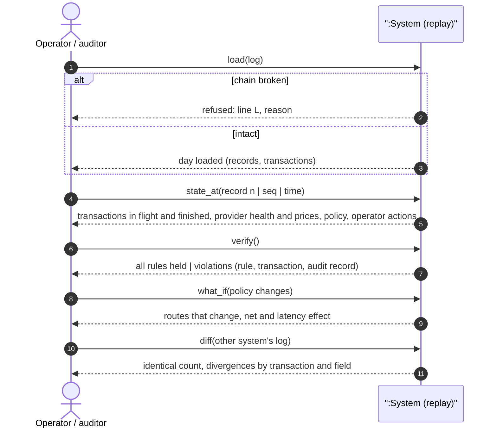
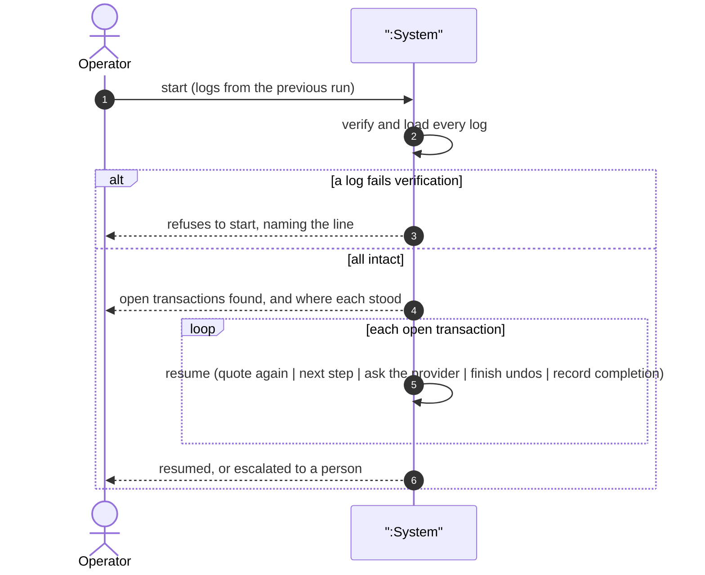
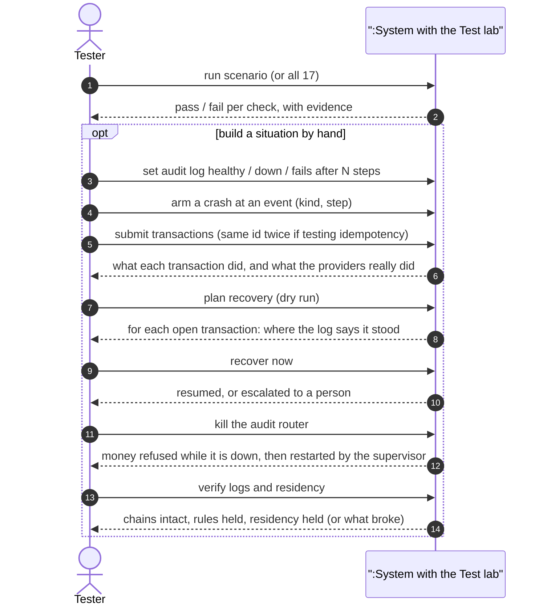
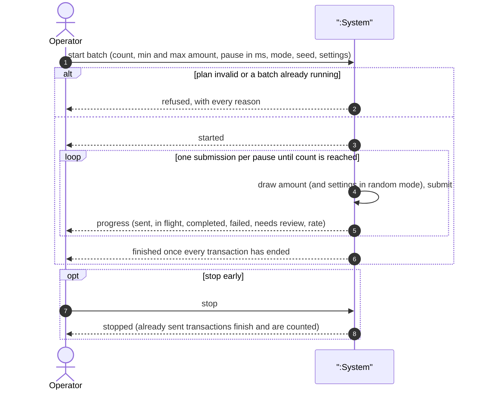
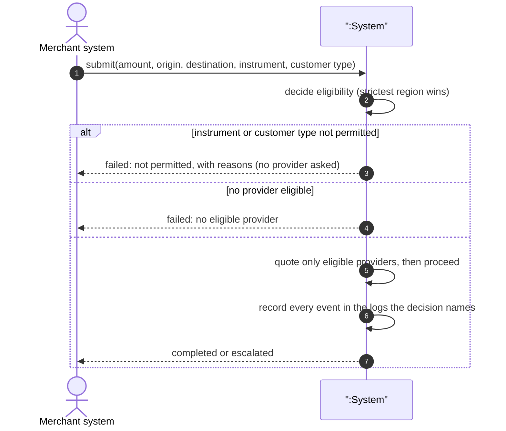

# 03 · System sequence diagrams (Larman style)

The system is a single black box (`:System`). Only the actors' requests and the
system's responses are shown; internals are in [04](04-design-sequences-and-activities.md).

## SSD-1 · Complete an FX swap and payment (UC-1)

## SSD-2 · Observe and operate (UC-2, UC-5)

## SSD-3 · Keep provider knowledge honest (UC-3)

## SSD-4 · Audit a transaction and prove the record is intact (UC-7)

## SSD-5 · Read what the system costs and saves (UC-8)

## SSD-6 · Replay the day (UC-9)

## SSD-7 · Restart and resume (UC-10)

## SSD-9 · Test the hard-to-reach behaviours (UC-12)

## SSD-10 · Send many transactions (UC-13)

## SSD-8 · Submit within a jurisdiction (UC-11)

