# 04 · Design sequences, activities and state machines

Design-level views of how the system realises the use cases. Diagrams are Mermaid
(UML 2.0 notation as closely as Mermaid allows: sequence combined fragments
`alt/opt/loop/par`, state machines, and activity flows with swimlanes).

## 4.1 Happy path (UC-1 main scenario)

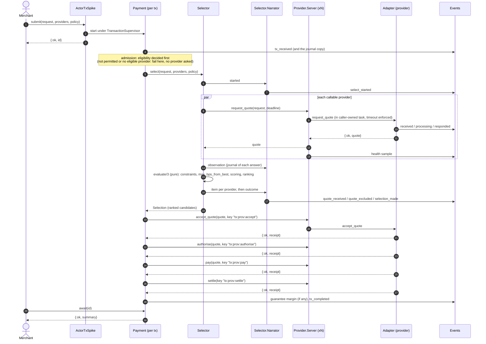

### 4.1b Inside a selection: decide, observe, narrate

`Selector.select/4` is a pipeline of small steps; the only judgement is the pure `evaluate/3`, which
replay calls with the recorded answers. Everything people read or replay needs is said by `Selector.Narrator`.

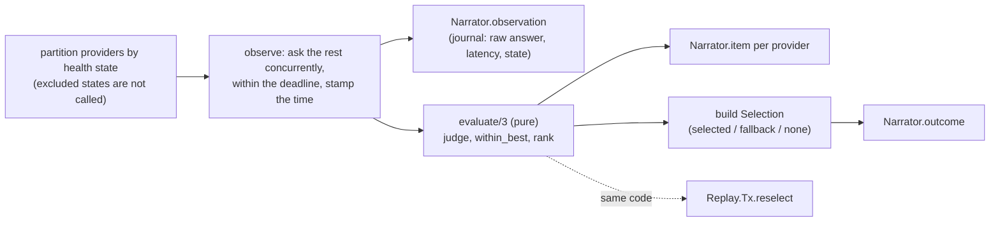

## 4.2 Authorise rejected: compensate and fail over (UC-1 ext 7a)

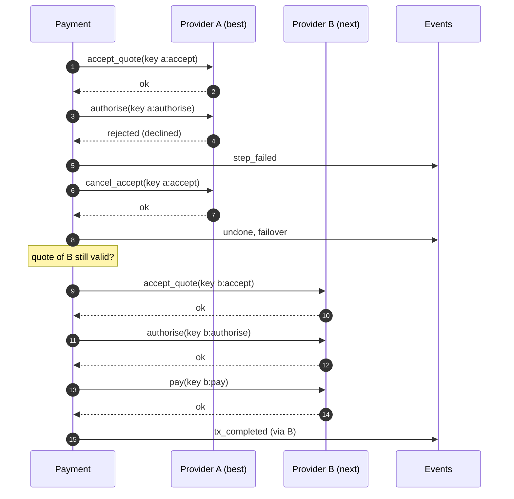

## 4.3 Payment answer lost: reconcile, never fail over (UC-1 ext 8b)

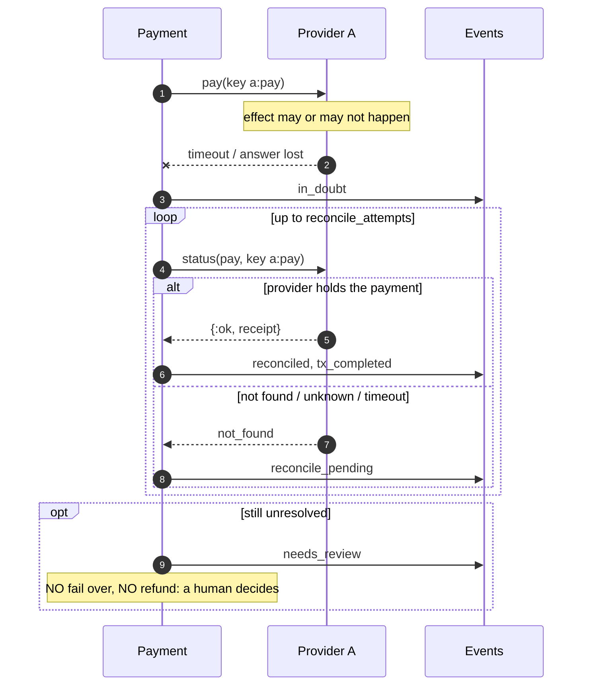

## 4.4 Sentinel detects drift (UC-3)

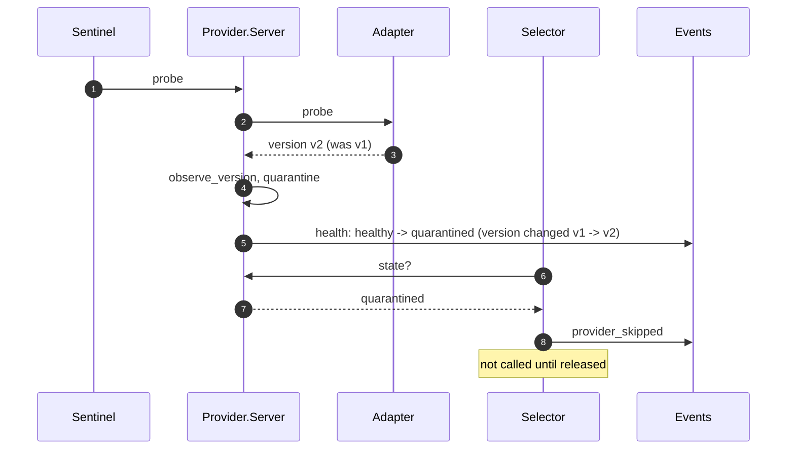

## 4.4b Deadline: cut-off passes mid-transaction

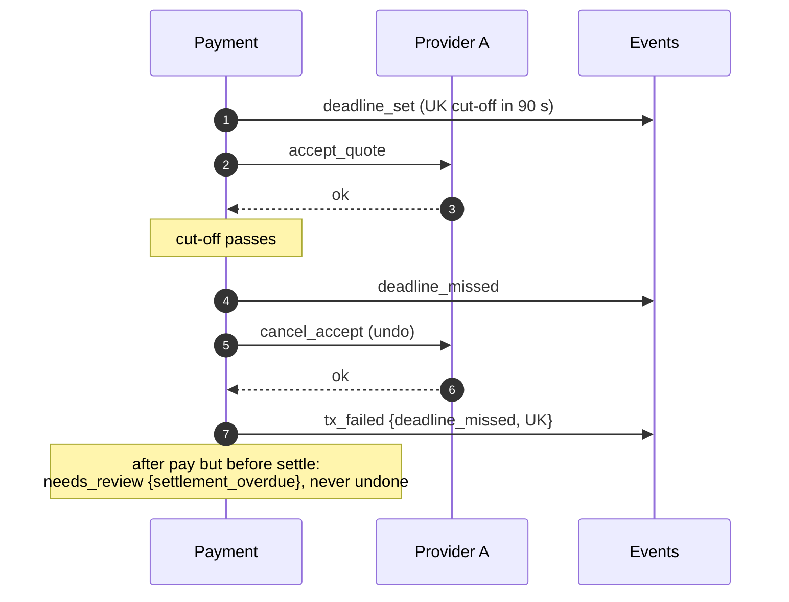

## 4.4c Measurement, pricing and evidence at the end of a transaction

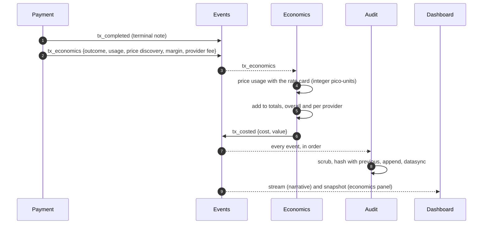

`Payment` only measures. It never prices, so the rate card can change without touching the
orchestrator, and the raw facts stay in the audit log so any cost figure can be recomputed.
Observation is fire-and-forget: if `Economics` or `Audit` is slow, payments are unaffected.
(The consequence for compliance is that a dead audit writer goes unnoticed: see the
compliance map, gap 1.)

### Audit log record lifecycle

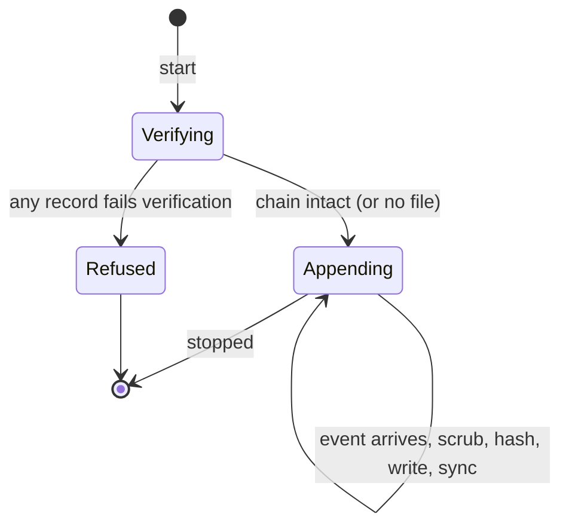

## 4.4d Recording and replaying the day

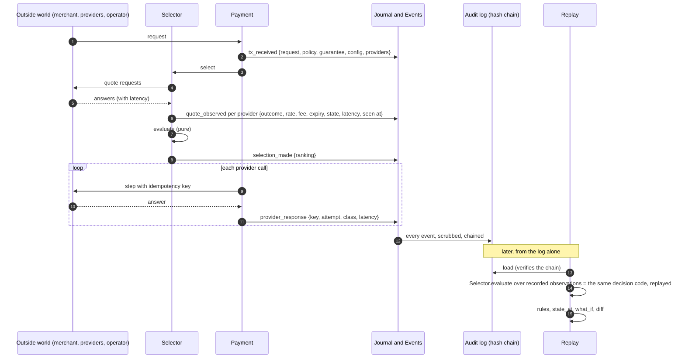

The pure `evaluate` function is the seam: live, it is fed what providers just said; in replay,
what the log says they said. See ADR 0009 for what this can and cannot replay.

## 4.4e Write-ahead, fail closed and regional routing

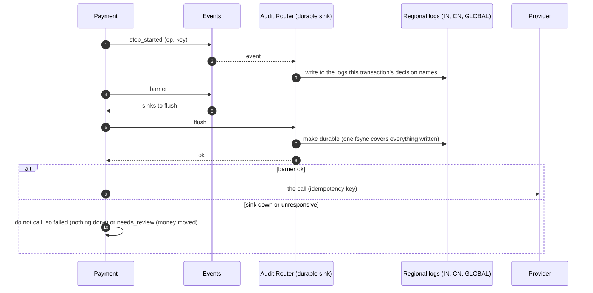

### Recovery decision

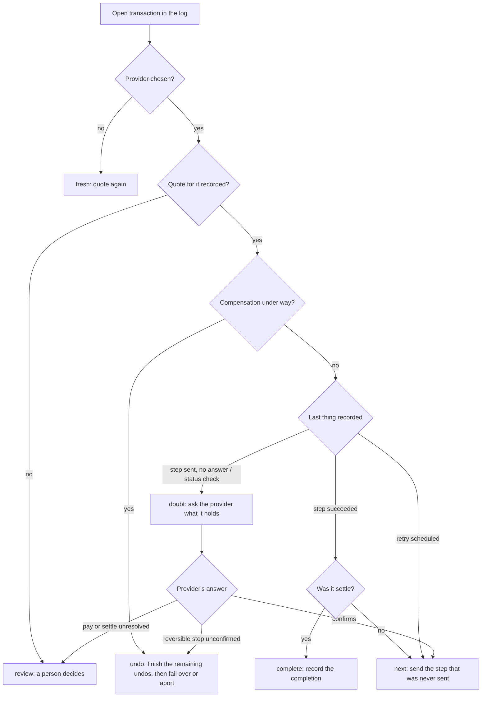

## 4.5 Activity: one transaction step (swimlane view)

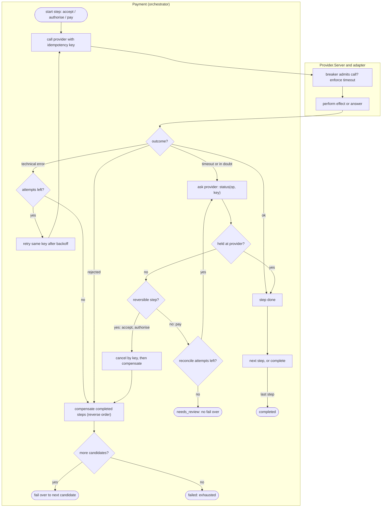

## 4.6 State machine: Payment

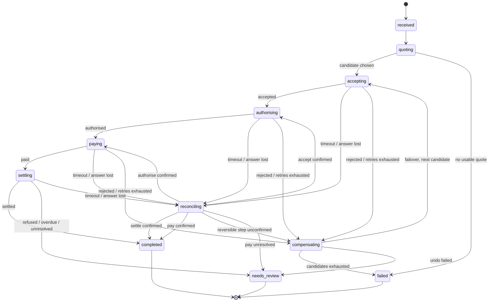

## 4.7 State machine: provider health and breaker

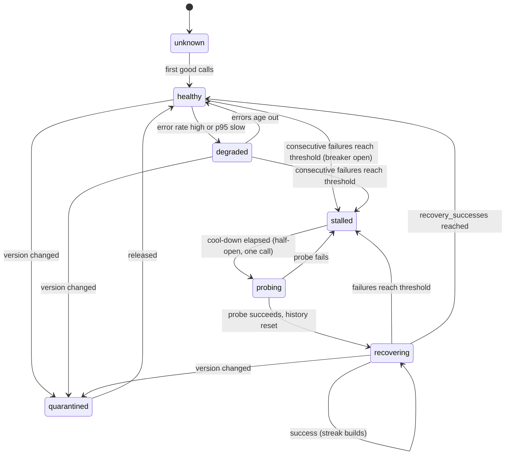
