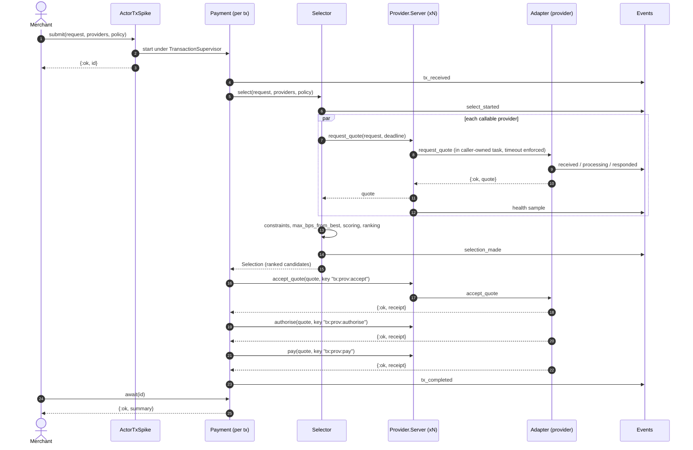
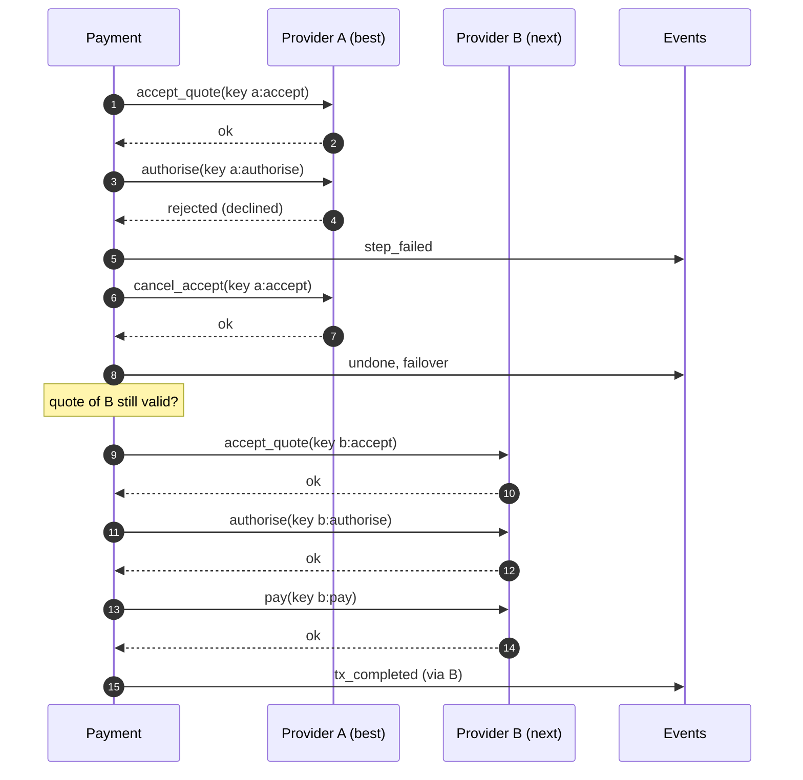
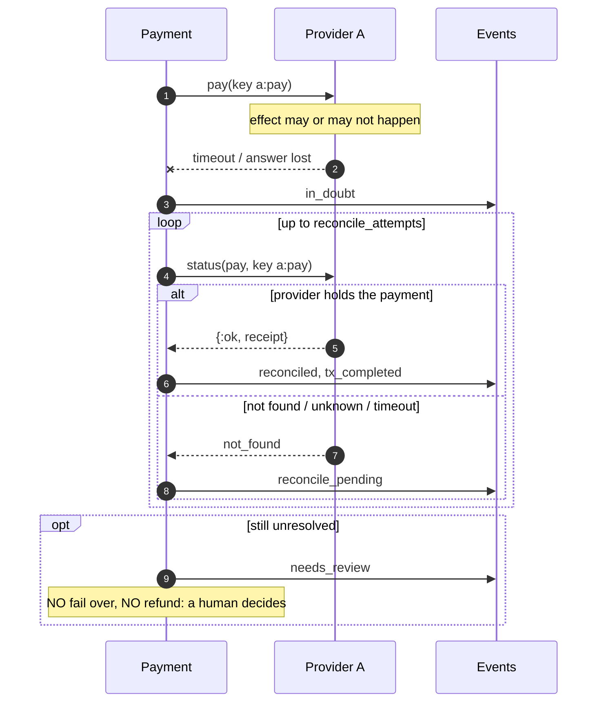
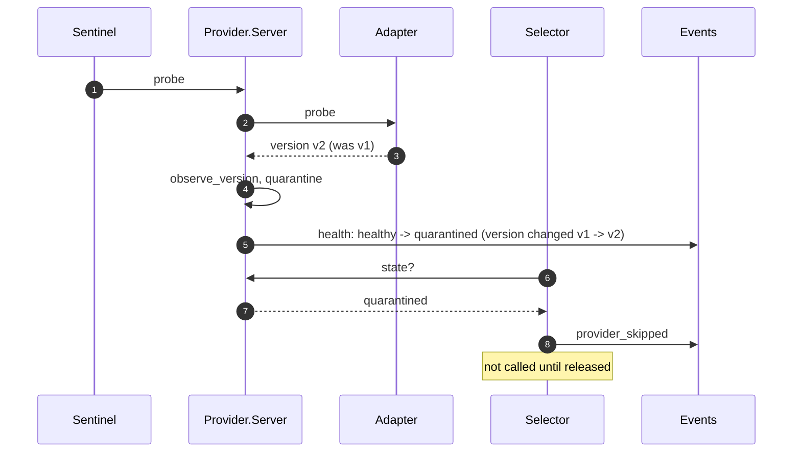
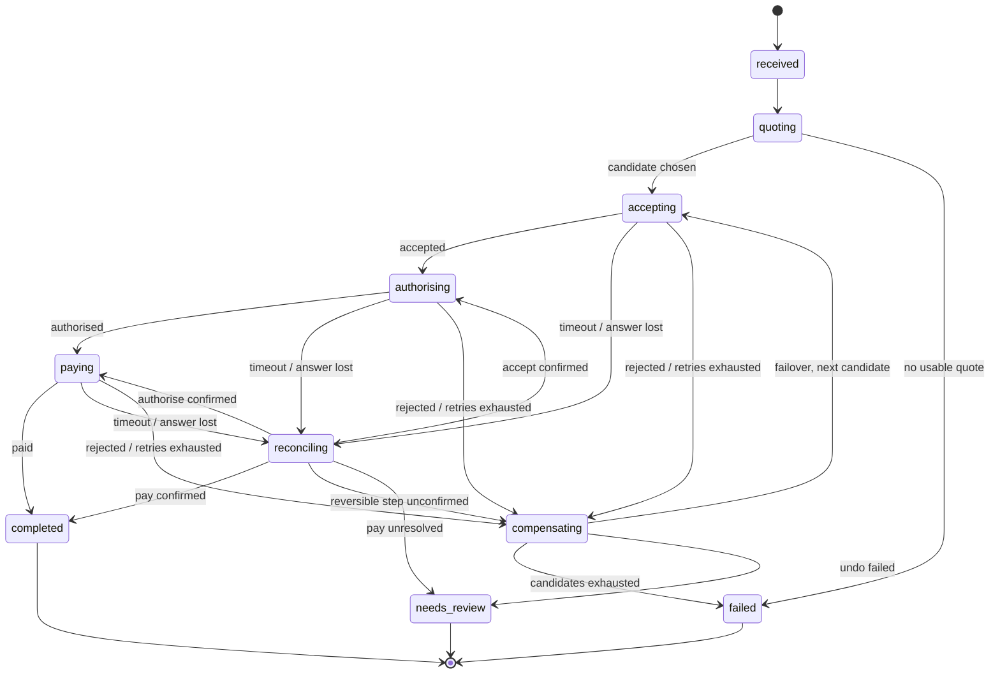
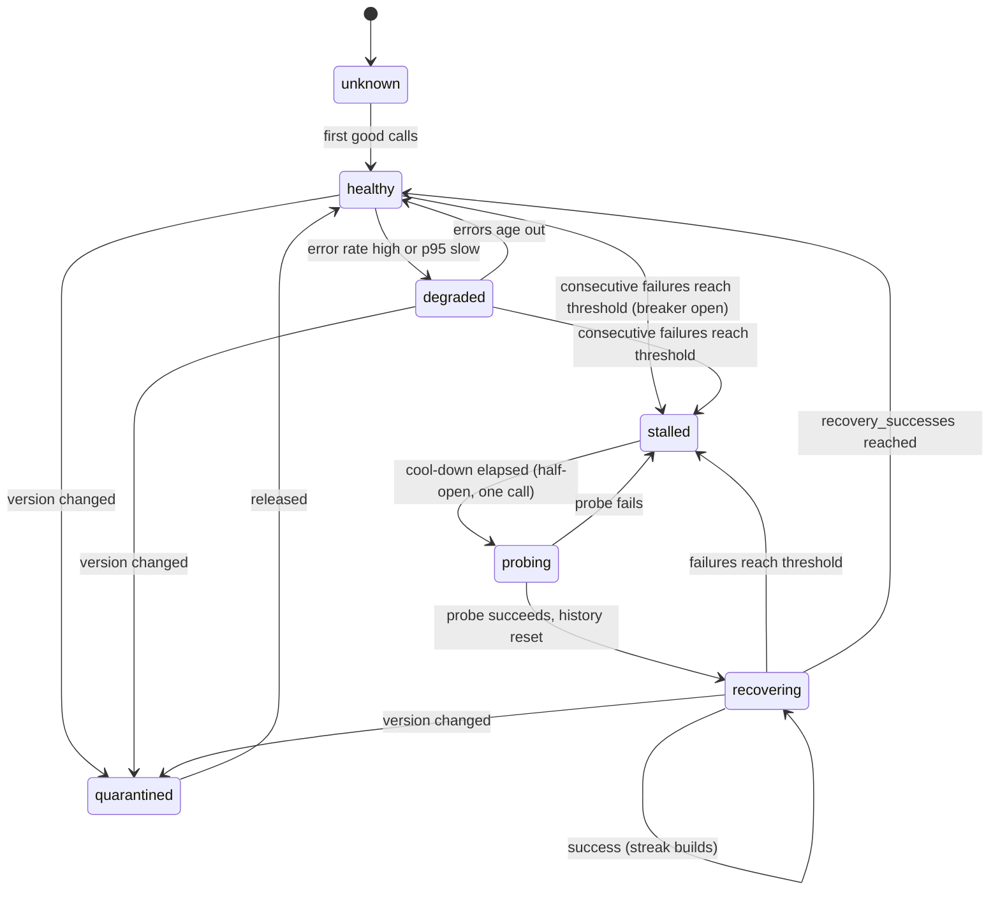

# 04 · Design sequences, activities and state machines

Design-level views of how the system realises the use cases. Diagrams are Mermaid
(UML 2.0 notation as closely as Mermaid allows: sequence combined fragments
`alt/opt/loop/par`, state machines, and activity flows with swimlanes).

## 4.1 Happy path (UC-1 main scenario)

## 4.2 Authorise rejected: compensate and fail over (UC-1 ext 7a)

## 4.3 Payment answer lost: reconcile, never fail over (UC-1 ext 8b)

## 4.4 Sentinel detects drift (UC-3)

## 4.5 Activity: one transaction step (swimlane view)

## 4.6 State machine: Payment

## 4.7 State machine: provider health and breaker

