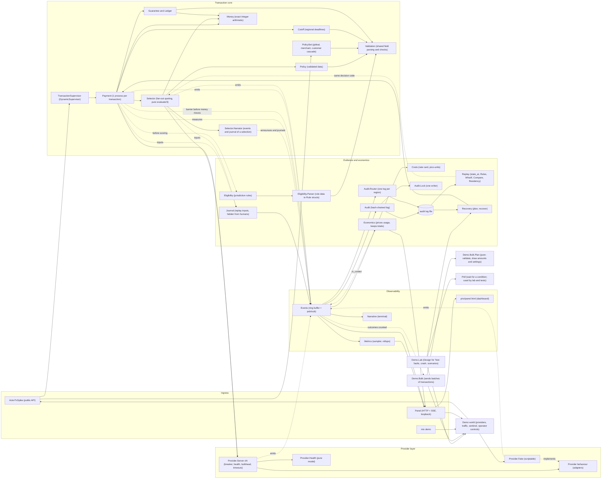
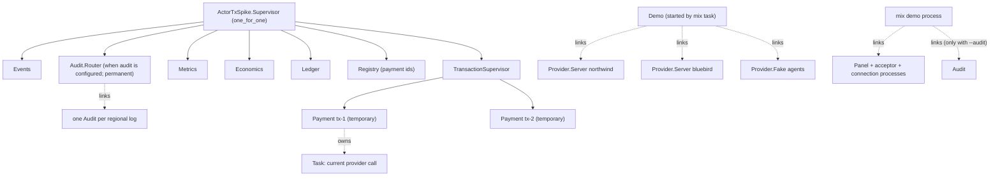
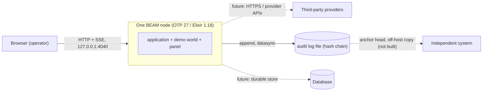

# 05 · System structure

## 5.1 Components

## 5.2 Supervision and process ownership

> **Known gaps:** Provider servers and the panel are *not* under the application's supervision
> tree today; they are linked to the demo. The audit router *is* supervised (when `audit` is
> configured): a dead writer makes the system fail closed, the supervisor restarts it, and
> production (`require_audit: true`) refuses to start without it. Open transactions are resumed
> from the log by `Recovery`, but recovery is run by the host at start (as `mix demo` does), not
> automatically by the application, because it needs the live provider registry.

## 5.3 Module responsibilities

| Module | Responsibility | Pure? |
|---|---|---|
| `ActorTxSpike` | Public API: submit / await / snapshot | no |
| `Payment` | Lifecycle, retries, compensation, reconcile, escalation | no (process) |
| `Selector` | Concurrent quoting within deadline; `evaluate/3` is the pure judgement shared with replay | `evaluate/3`: **yes** |
| `Selector.Narrator` | The story of a selection: events people read and the journal records replay reads | no |
| `Validation` | The shared shape of "plain data to validated struct": parse each field, collect every error | **yes** |
| `Poll` | Wait for a condition by asking again (one place that sleeps-and-retries) | no |
| `Policy` | Validated routing policy, constraints, scoring | **yes** |
| `Provider` | Adapter behaviour and result vocabulary | n/a |
| `Provider.Health` | Breaker, rolling stats, drift quarantine, recovery | **yes** |
| `Provider.Server` | Admission, bulkhead, enforced timeouts, health events | no |
| `Provider.Fake` | Scriptable provider and its narration | no |
| `PolicySet` | Cascading objectives with entitlement and validation | **yes** |
| `Cutoff` | Regional cut-offs: fixed offset or date-aware offset function | **yes** |
| `Guarantee` | Margin / exposure against a standing guarantee | **yes** |
| `Ledger` | Accumulates guarantee outcomes per merchant and period | no |
| `Money` | Exact integer money: decimal parsing, half-even rounding, display formatting | **yes** |
| `Costs` | Rate card and pricing of measured usage into pico-units | **yes** |
| `Economics` | Prices each finished transaction, keeps totals overall and per provider, announces `tx_costed` | no (process) |
| `Audit` | Hash-chained append-only log, verification, card-number scrubbing | no (process) |
| `Journal` | Records replay inputs (actor `:journal`, hidden from humans) | no |
| `Eligibility` (+ `Rule`, `Parser`) | Jurisdiction rules: eligible providers, permitted instruments and customer types, logs, retention; strictest region wins | **yes** |
| `Audit.Router` | One hash-chained log per region; routes each transaction's events to the logs its decision names; fails closed | no (process) |
| `Audit.Lock` | One writer per log (lock file naming the owner; stale locks taken over) | no |
| `Recovery` | Pure plan of where an open transaction stood; recovery of every open transaction from the logs | plan: **yes** |
| `Replay` (+ `Tx`, `Rules`, `WhatIf`, `Compare`, `Residency`, `Report`) | Load a verified day; state at a moment; rule verification; strategy what-if; comparison with another system; text reports | **yes** |
| `Metrics` (+ `Stats`, `Rollup`, `VM`) | Resource and application metrics with bounded rollups | mostly |
| `Events`, `Narrative` | Narrative stream and rendering | no |
| `Panel`, `Demo` | Dashboard server (`/api/snapshot`, `/metrics`, `/lab`, `/bulk`, `/events`, `/control`) and demo world | no |
| `Demo.Bulk` | Sends a batch of transactions through the demo at a set pace and counts how each ends (see [09](09-bulk-send.md)) | no |
| `Demo.Bulk.Plan` | Validates a batch plan; draws each transaction's amount and (in random mode) settings from a seeded random state | **yes** |
| `Demo.Lab` (+ `Scenarios`) | Design for Test: audit fault injection, crash watcher, plan/recover/resend, 17 scenarios with checks (see [08](08-test-lab.md)) | no |

The decision-heavy logic (`Policy`, `Health`, `Selector.evaluate/3`, `Eligibility`, `Recovery.plan/1`) is deliberately pure so it can be tested exhaustively.

### Shape rules the structure follows

These are enforced by Credo (see the [quality limits](../DEVELOPER_GUIDE.md#3-quality-limits-and-how-they-are-enforced)): a function has at most **4** decision points (cyclomatic complexity), at most **40** ABC size, and no repeated block of about 16 nodes. In practice that is why the structure looks like this: decisions live in function clauses and small named helpers (`Validation`, `Parser`, `Narrator`), not in nested `if`/`case`, and one concern gets one module (deciding, narrating and parsing are separate).

## 5.4 Deployment view (today)

Single node. The audit log is now also the recovery store: open transactions resume from it after a restart. Deals that live for days (forwards) are not yet modelled. No external network calls (providers are fakes).

## 5.5 Dependencies

* **Runtime:** none beyond OTP/Elixir standard library (JSON module from Elixir 1.18).
* **Dev/test only:** credo, sobelow, mix_audit (and their transitive deps).
* **Tooling entry points:** `mix demo` (`--audit`, `--audit-dir`; resumes open transactions at start), `mix audit.verify`, `mix replay` (including `residency`).
