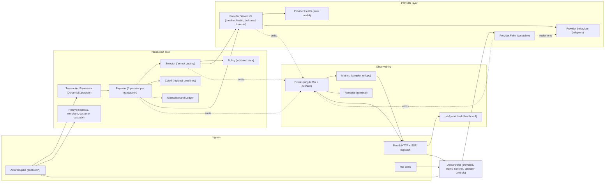
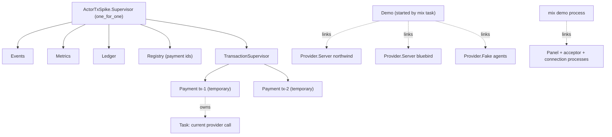
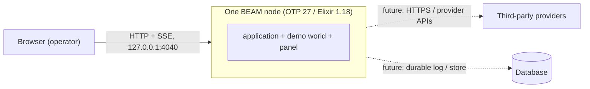

# 05 · System structure

## 5.1 Components

## 5.2 Supervision and process ownership

> **Known gap:** Provider servers and the panel are *not* under the application's
> supervision tree today; they are linked to the demo. A production deployment needs
> them supervised (and Payment processes restarted from a durable log).

## 5.3 Module responsibilities

| Module | Responsibility | Pure? |
|---|---|---|
| `ActorTxSpike` | Public API: submit / await / snapshot | no |
| `Payment` | Lifecycle, retries, compensation, reconcile, escalation | no (process) |
| `Selector` | Concurrent quoting within deadline, ranking, narration | no |
| `Policy` | Validated routing policy, constraints, scoring | **yes** |
| `Provider` | Adapter behaviour and result vocabulary | n/a |
| `Provider.Health` | Breaker, rolling stats, drift quarantine, recovery | **yes** |
| `Provider.Server` | Admission, bulkhead, enforced timeouts, health events | no |
| `Provider.Fake` | Scriptable provider and its narration | no |
| `PolicySet` | Cascading objectives with entitlement and validation | **yes** |
| `Cutoff` | Regional cut-offs: fixed offset or date-aware offset function | **yes** |
| `Guarantee` | Margin / exposure against a standing guarantee | **yes** |
| `Ledger` | Accumulates guarantee outcomes per merchant and period | no |
| `Metrics` (+ `Stats`, `Rollup`, `VM`) | Resource and application metrics with bounded rollups | mostly |
| `Events`, `Narrative` | Narrative stream and rendering | no |
| `Panel`, `Demo` | Dashboard server and demo world | no |

The decision-heavy logic (`Policy`, `Health`) is deliberately pure so it can be tested exhaustively.

## 5.4 Deployment view (today)

Single node, no persistence, no external network calls (providers are fakes).

## 5.5 Dependencies

* **Runtime:** none beyond OTP/Elixir standard library (JSON module from Elixir 1.18).
* **Dev/test only:** credo, sobelow, mix_audit (and their transitive deps).
