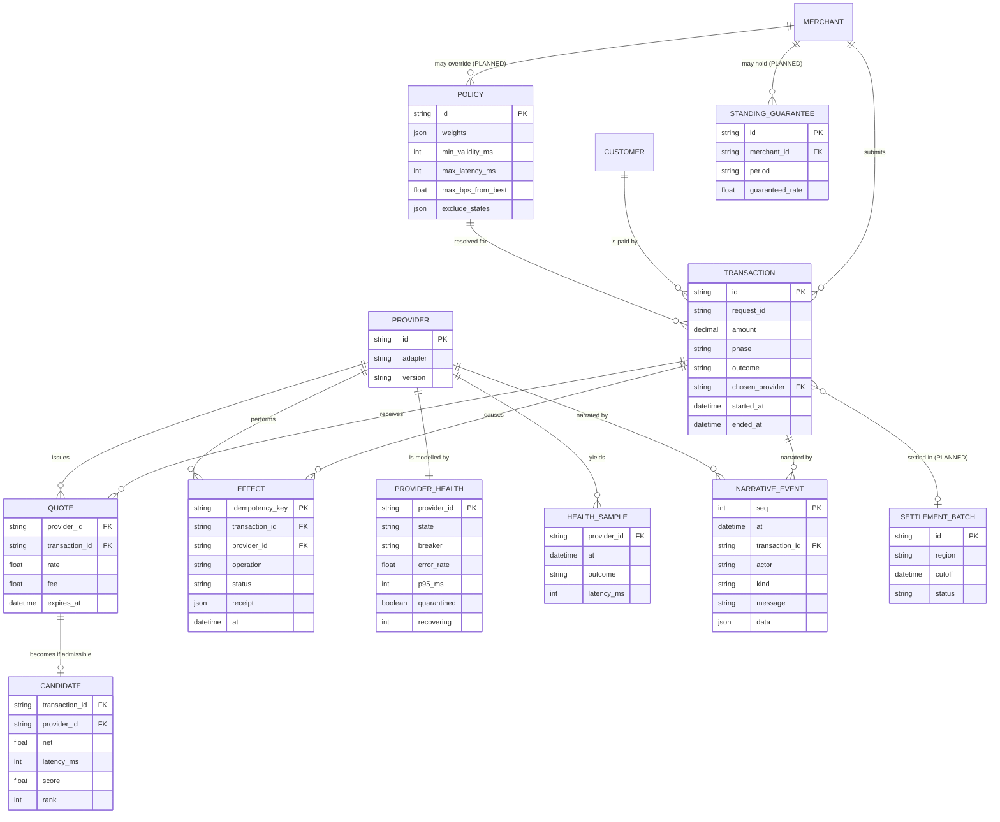

# 06 · Data model

**Honest status:** nothing is persisted today. These are the entities as they exist
in process memory and in the event stream, followed by the logical model the durable
store (roadmap Phase 3) should implement. `PLANNED` marks things that do not exist yet.

## 6.1 Logical entity-relationship model

## 6.2 Where each entity lives today

| Entity | Today | Planned |
|---|---|---|
| Transaction | `Payment` process state (lingers 30 s after finishing) | Event-sourced log; projections for status |
| Quote / Candidate / Selection | In the `Payment` process and the narrative `data` | Persisted with the decision rationale |
| Effect | Provider-side only (in the fake); our side is in the narrative | Own table keyed by idempotency key (outbox/inbox) |
| ProviderHealth / HealthSample | `Provider.Server` state (rolling window of 20) | Time series with retention (see [07](07-observability-and-performance.md)) |
| NarrativeEvent | `Events` ring buffer, 1,000 events | Append-only log, partitioned, retention policy |
| Policy | Value held by the demo | Versioned config, cascade global → merchant → customer |
| Merchant, Customer, StandingGuarantee, SettlementBatch | do not exist | Slice 3 and Phase 3 |

## 6.3 Invariants the model must keep

1. At most one `pay` effect per transaction.
2. An effect row is unique per `idempotency_key`.
3. A transaction's `chosen_provider` is the provider of its `pay` effect when `outcome = completed`.
4. A `failed` transaction has no `pay` effect and every `accept` / `authorise` has a matching undo.
5. `needs_review` is the only state that may hold un-undone effects, and it must carry the reason.
6. Narrative `seq` is strictly increasing; events are never edited.

Invariants 1, 3 and 4 are executable today: see
`test/integration/payment_invariants_test.exs`.
