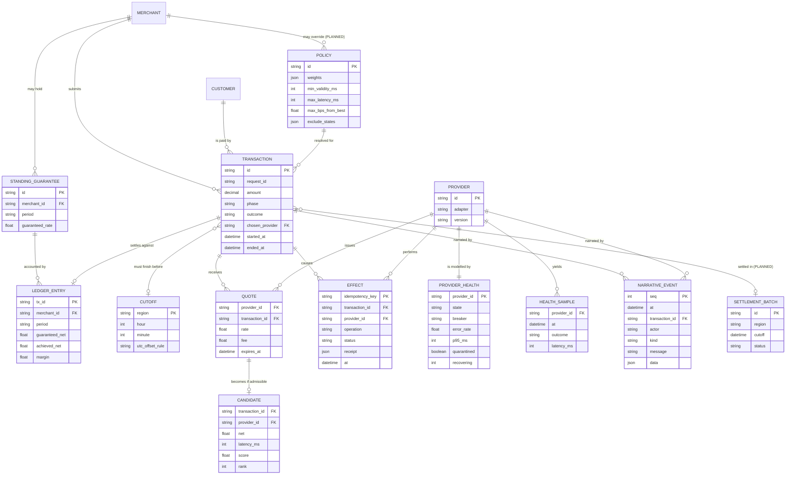
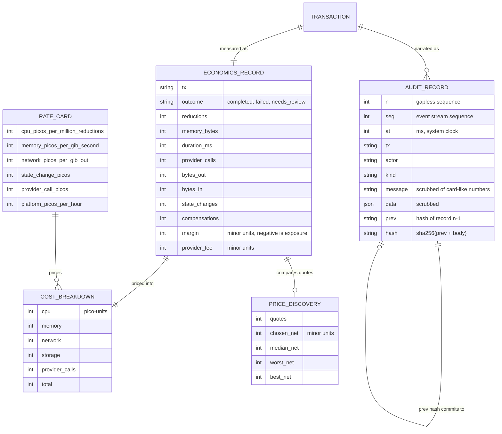
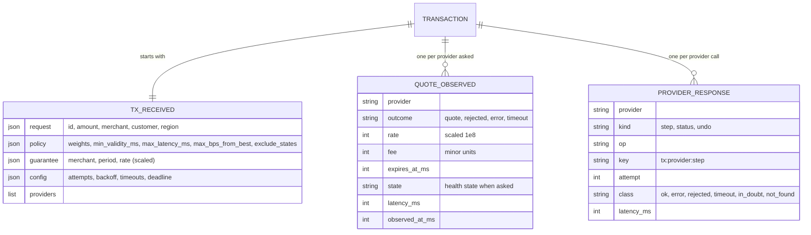
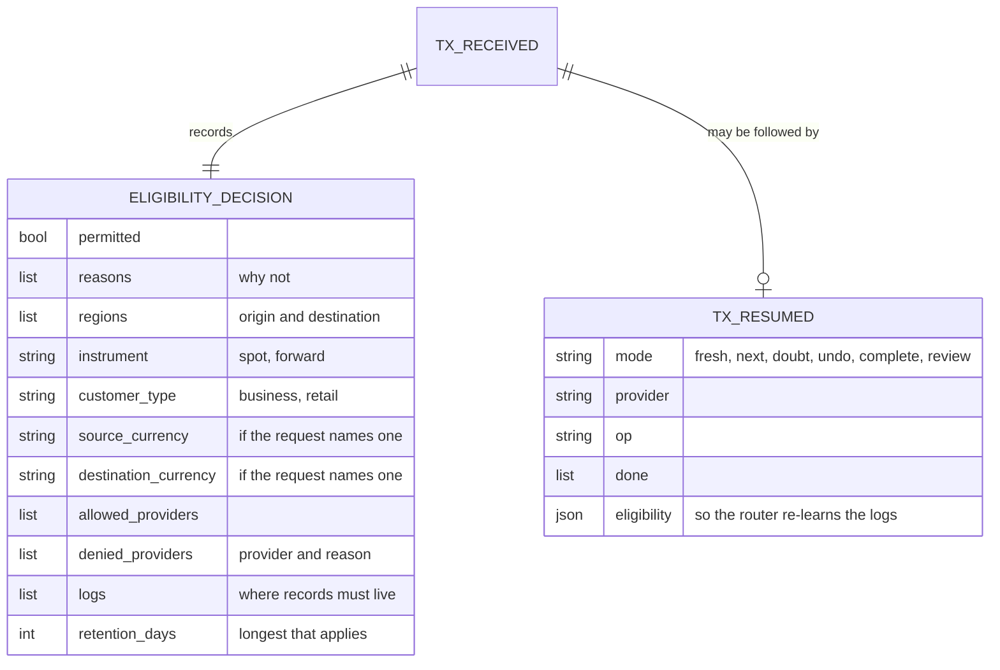
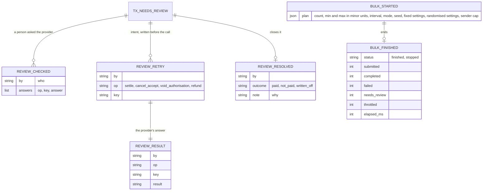

# 06 · Data model

**Honest status:** nothing is persisted today. These are the entities as they exist
in process memory and in the event stream, followed by the logical model the durable
store (roadmap Phase 3) should implement. `PLANNED` marks things that do not exist yet.

## 6.1 Logical entity-relationship model

## 6.2 Where each entity lives today

| Entity | Today | Planned |
|---|---|---|
| Transaction | `Payment` process state (lingers 30 s after finishing) | Event-sourced log; projections for status |
| Quote / Candidate / Selection | In the `Payment` process and the narrative `data` | Persisted with the decision rationale |
| Effect | Provider-side only (in the fake); our side is in the narrative | Own table keyed by idempotency key (outbox/inbox) |
| ProviderHealth / HealthSample | `Provider.Server` state (rolling window of 20) | Time series with retention (see [07](07-observability-and-performance.md)) |
| NarrativeEvent | `Events` ring buffer, 1,000 events | Append-only log, partitioned, retention policy |
| StandingGuarantee, LedgerEntry | `Guarantee` struct; `Ledger` process (in memory, idempotent per transaction) | Durable ledger |
| Cutoff | `Cutoff` struct supplied per region | Reference data with a timezone database |
| Policy layers (merchant, customer) | `PolicySet` value | Versioned, audited configuration |
| Merchant, Customer, SettlementBatch | merchant and customer exist only as ids in requests / policy layers | Phase 3 |

## 6.3 Invariants the model must keep

1. At most one `pay` effect per transaction.
2. An effect row is unique per `idempotency_key`.
3. A transaction's `chosen_provider` is the provider of its `pay` effect when `outcome = completed`.
4. A `failed` transaction has no `pay` effect and every `accept` / `authorise` has a matching undo.
5. `needs_review` is the only state that may hold un-undone effects, and it must carry the reason.
6. Narrative `seq` is strictly increasing; events are never edited.

Invariants 1, 3 and 4 are executable today: see
`test/integration/payment_invariants_test.exs`.

## Evidence and economics (added 2026-10-17)

Money is held as integers (ADR 0008): amounts and fees in minor units, rates scaled by 10^8,
costs in pico-units.

## Journal schema v1 (added 2026-10-17)

> Unchanged by the 2026-10-20 refactor. A recorded quote is rebuilt in exactly one place,
> `Replay.Tx.quotes/1` / `quote_from/1`, which both replay and recovery use.

Journal events live in the same stream and audit log as the narrative (actor `journal`).
Together with the existing narrative kinds they are the replay script.

Also journalled: `control` (operator and world actions, with their arguments) and the
provider `health` events. Decisions are recorded by the existing `selection_made`
(ranking and scores), `provider_chosen`, `step_*`, `failover`, `undone`, `deadline_set`,
guarantee and `tx_economics` events.

## Jurisdiction, recovery and the lock (added 2026-10-17)

`tx_received` now also carries the eligibility decision; `tx_resumed` records a recovery.

Files per log directory: `<region>.log` (the hash chain) and `<region>.log.lock`
(`"<os pid> <erlang pid>"`, present while a writer holds the log).

## Review and batch records (added 2026-10-23)

A transaction that went to review gains records after its costing, in the same regional logs; a bulk batch leaves a start and an end record
(with no transaction).

`Replay.Tx.summarize` gains `resolution` (the last resolution's outcome, or none); `Replay.batches/1` reads the batch records; the review queue
is rebuilt with `Review.Queue.from_records/1`. The request carries `source_currency` and `destination_currency` when given.

