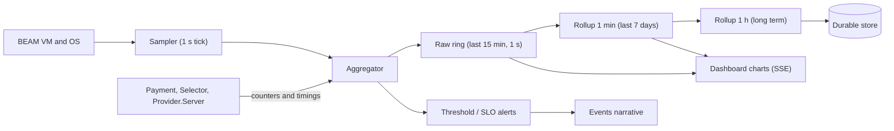

# 07 · Observability and performance monitoring (design)

**Status: built (first version).** The narrative (what is happening) and the resource /
performance metrics (how much it costs) both exist. This document records the design and
marks what is implemented. Not yet built: long-term storage metrics (there is no durable
store), alerting, retention beyond the in-memory rollups, and the 1-hour tier.

## 7.1 Two kinds of observability

| Question | Mechanism | Status |
|---|---|---|
| *What is the system doing, and why?* | `Events` narrative → dashboard / terminal | ✅ built |
| *How healthy and how expensive is it?* | `ActorTxSpike.Metrics` sampler → `/api/metrics` → Performance view | ✅ built (1 s sampling, 1 min rollups) |

Keep the two separate: the narrative is high-cardinality and per-transaction; metrics are
low-cardinality numbers sampled over time.

## 7.2 Metric catalogue

### Resource metrics (BEAM and host)

| Metric | Source | Why it matters |
|---|---|---|
| Memory by category (total, processes, binary, ets, atom, code) | `:erlang.memory/0` | Leaks (binary, ets), growth per transaction |
| Top-N process memory / message queue length | `:erlang.process_info/2` | Mailbox build-up = backpressure problem; finds the slow actor |
| Scheduler utilisation (per scheduler) | `:erlang.statistics(:scheduler_wall_time)` | True CPU saturation of the VM |
| Run-queue length | `:erlang.statistics(:total_run_queue_lengths)` | Latency risk before CPU hits 100% |
| Reductions per process | `process_info(pid, :reductions)` deltas | Per-actor CPU attribution (which provider facade, which transaction) |
| GC count and words reclaimed | `:erlang.statistics(:garbage_collection)` | Allocation pressure |
| Network bytes in / out | `:erlang.statistics(:io)`; `:inet.getstat/2` per socket | Network efficiency, SSE fan-out cost |
| Outbound payload bytes and calls per provider | Application counters in `Provider.Server` | Cost and rate-limit headroom per third party |
| Storage used, growth rate, log size, retention | `File.stat`, `:disksup` (os_mon) | Long-term storage budget |
| Host CPU and memory | `:cpu_sup`, `:memsup` (os_mon) | Context for VM numbers |

### Application metrics (SLIs)

| Metric | Definition |
|---|---|
| Throughput | Transactions per second by outcome |
| End-to-end latency | submit → terminal, p50 / p95 / p99 |
| Step latency | per provider, per operation |
| Failover rate | transactions that used a non-first candidate |
| Needs-review count and age | the human-attention queue |
| Provider error / timeout rate | per provider, rolling |
| Quote spread and selection margin | best vs runner-up net value |
| Value vs baseline | net value gained vs the default route (the money KPI) |
| Event buffer drops | observability health |

## 7.3 Collection architecture

Principles:

1. **Sampling, not tracing, for resources.** One sampler process, fixed cost regardless of load.
2. **In-process aggregation.** Counters are cheap atomics / ETS counters; never a message per measurement.
3. **Bounded memory.** Ring buffers with fixed capacity; observability must not become the leak.
4. **Tiered retention.** Raw → 1 min → 1 h so long-term storage grows slowly and predictably.
5. **Alerts go into the narrative** so the same dashboard explains what changed.
6. **Overhead budget:** the monitoring layer must stay under ~1% CPU and a fixed memory cap, and is itself measured.

### Storage estimate

At 60 numeric series sampled every second, 8 bytes each:

| Tier | Resolution | Retention | Approx. size |
|---|---|---|---|
| Raw | 1 s | 15 min | ~0.4 MB (memory) |
| Rollup | 1 min (min / mean / max / p95 = 4 values) | 7 days | ~7 MB |
| Rollup | 1 h (4 values) | 1 year | ~8 MB |

Event narrative at ~15 events per transaction, ~350 bytes each ≈ 5 KB / transaction:
1 million transactions ≈ 5 GB before compression, which is why the log needs
partitioning and a retention policy (e.g. full detail 30 days, summaries after).

## 7.4 Charts (dashboard "Performance" tab)

| Chart | Type | Answers |
|---|---|---|
| Memory by category | stacked area | What is growing? |
| Scheduler utilisation | per-scheduler lines + run queue | Are we CPU bound? |
| Top processes by reductions / mailbox | table with sparkline | Which actor is hot? |
| Network in / out | dual line | Efficiency; SSE cost |
| Provider latency distribution | heatmap per provider over time | Who is decaying? |
| Transaction funnel | stacked bar per minute by outcome | Throughput and failure mix |
| End-to-end latency percentiles | line (p50 / p95 / p99) | SLO tracking |
| Value vs baseline | cumulative line | Is routing earning its keep? |
| Storage growth | line + projection | When do we run out? |
| Observability overhead | small line | Is the monitor cheap? |

## 7.5 Service-level objectives (starting proposals)

| SLO | Target |
|---|---|
| End-to-end p95 for a healthy market | < 2 × slowest chosen provider latency + 100 ms |
| Never-paid-twice violations | 0 (alert page on any) |
| `needs_review` age | 99% resolved < 1 business hour |
| Event stream lag to dashboard | < 1 s |
| Monitoring overhead | < 1% CPU, bounded memory |

## 7.6 Implementation status

| Item | Status |
|---|---|
| VM sampler: memory by category, CPU, scheduler utilisation, run queue, reductions, GC, processes, ports | ✅ `Metrics` + `Metrics.VM` |
| Network: TCP bytes in/out, socket count | ✅ |
| Top processes by memory and mailbox | ✅ (every 5th sample) |
| Application metrics from the narrative: throughput by outcome, failovers, end-to-end p50/p95/p99, provider health | ✅ |
| Own overhead measured per sample | ✅ (about 1.5–2.5 ms per sample in the demo) |
| Raw ring (15 min, 1 s) and 1-minute rollups (24 h) | ✅ bounded |
| Performance view with charts and window selector | ✅ |
| 1-hour rollups, durable tier, storage growth chart | 🔲 needs the Phase 3 store |
| Alerts into the narrative; SLO tracking | 🔲 |
| Load generator / benchmark mode | 🔲 |
| `:telemetry` conventions for external tools | 🔲 |

Known limits: per-process CPU attribution uses reductions in the top-process table only;
host CPU/memory (`os_mon`) is not collected; network figures cover this VM's TCP sockets,
including the dashboard's own polling.
