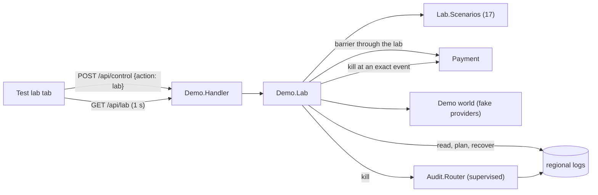

# 08 · The Design for Test lab

A **Test lab** tab in the dashboard (`mix demo --lab`) that makes the hard-to-reach behaviours
easy to provoke and to judge: the regional log router, idempotency, restarts and recovery, and
what the system does when the durable log is unavailable, depending on where each transaction
stood. It drives the live demo world and reads the durable logs through `Replay`; it owns no
domain logic.

## What you can do on the tab

| Panel | Controls | What it shows |
|---|---|---|
| **Scenarios** | Run one, Run all, Clear | A card per scenario: what it does, what to expect, pass/fail/skipped, each check with its evidence, and clickable transaction ids that jump to that transaction's story on the Live tab |
| **Audit log** | Healthy, Down, *Fails after N steps*, Kill the router, Verify logs + residency | Router up and supervised, each regional log's record count and head hash, the current fault mode, per-log rule results and the residency proof |
| **Crash and recover** | Arm *(kill the next transaction when KIND OP happens)*, Disarm, Plan recovery (dry run), Recover now | What is armed, which transactions were killed and where, and for each open transaction what the log says: mode, provider, step, steps done, undos left, whether it is still running |
| **Idempotency** | Submit the same id twice; re-send a step with the same key | Whether the second submission was the same transaction; the provider's answer and its effect before and after the re-send, and whether it was unchanged |
| **What the providers actually did** | none | A provider by operation table of effects that really happened (accept, authorise, pay, settle, and the undos): the ground truth the checks are judged against |

The header's submit controls (amount, merchant, region, instrument, customer type) stay visible,
so any state can be set up by hand and then inspected.

## How the faults work

- **Audit log down / fails after N steps.** Each transaction's durable-log barrier goes through the
  lab (`Lab.barrier_fun/1`), which counts calls per transaction. *Down* refuses every step;
  *after N* lets the first N barriers through and then fails with `disk_full`. This is exactly
  the signal `Payment` already reacts to, so a transaction that has done nothing fails
  (`audit_unavailable`) and one that has moved money stops in `needs_review`.
- **Crash at an exact point.** A watcher subscribes to the event stream and kills the transaction
  process the moment the armed event happens (for example `step_succeeded authorise`, or
  `step_started pay` with the call already in flight), as a node dying at that instant would.
  The provider keeps its state, as a real provider would.
- **Recover.** The plan is `Recovery.plan` over the logs; recovering is `Recovery.recover`.
- **Kill the router.** The router is under a supervisor in lab mode. While it is down the barrier
  fails (money stops); when it is restarted it re-registers and rebuilds its routing table.
- **Known conditions.** Before each scenario the lab pauses price drift, fixes prices so cobalt
  is the best provider, heals every provider, restores a healthy log and clears armed crashes, so
  scenarios are deterministic. It leaves pace at 0.3.

## The scenario library

| Scenario | Provokes | Expected |
|---|---|---|
| Happy path | nothing | completed via cobalt; each step done once |
| India corridor | spot to IN | via an eligible provider; recorded in IN only |
| China corridor | spot to CN | via meridian; recorded in CN only |
| Forward to India | a forward in IN | refused before any provider is asked |
| Same id twice | idempotent submit | one transaction; pay once |
| Re-send same key | idempotent steps | effects unchanged |
| Authorise rejected | failover | other provider; cobalt's accept cancelled; one payment |
| Pay answer lost | doubt resolved | via cobalt; pay once |
| Pay never confirmable | unresolved pay | `needs_review`; nobody else asked; no refund |
| Settle refused | no undo after pay | `needs_review`; not refunded |
| Audit down at start | fail closed | failed; no provider did anything |
| Audit fails after two steps | fail closed mid-way | `needs_review`; accept and authorise done, pay not |
| Crash after authorise | restart | recovered; paid at most once |
| Crash with pay in flight | restart in doubt | completed or held; paid at most once |
| Crash while undoing | restart mid-compensation | undo finished; completed elsewhere |
| Router killed | supervision | refused while down; restarted; new transaction completes |
| Logs verify | chain, rules, residency | all intact |

Scenarios that need the regional logs are **skipped** (not failed) when the demo was started
without them.

## The library is also a regression suite

`test/integration/lab_test.exs` starts the demo, the supervised router and the lab, runs every
scenario and requires each to pass with at least two checks. A change that breaks idempotency,
recovery, fail-closed behaviour or residency fails that test.

## Limits

- It drives the simulated world; it proves the orchestration, not a real provider's behaviour.
- A crash trigger matches the *next* matching event of *any* transaction.
- The audit-fault modes are injected at the barrier; they do not damage the files (the real
  disk-full and tamper cases are covered by unit tests).
- Resumed transactions bypass the lab's fault injection (they use the demo's ordinary barrier).
