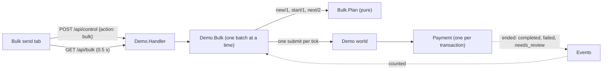

# 09 · Bulk send

A **Bulk send** tab in the dashboard sends many transactions into the demo world, with a random
amount between a minimum and a maximum, a settable pause between submissions, and (optionally) every
other setting drawn at random per transaction. It is a load and variety generator: it makes the
system do thousands of things so you can watch it, and it is the first tool in the repository that
can answer "what happens at 10,000?". It starts with `mix demo` (no `--lab` needed).

## What you can do on the tab

| Panel | Controls | Effect |
|---|---|---|
| **Batch** | number of transactions (10, 100, 1,000, 10,000 or any 1 to 10,000), smallest and largest amount, pause between transactions in ms (0 to 60,000), optional seed, and **sender waits at N in flight** (0 = no limit) | the shape of the batch; every transaction gets an amount drawn uniformly between the two (the same value if they are equal) |
| **Send with the header settings** | *Send the batch* | every transaction uses the merchant, customer, region, instrument, customer type and currencies chosen in the header; only the amount varies |
| **Randomise everything** | a tick box per setting (merchant, customer, origin region, destination region, instrument, customer type, from currency, to currency), *Randomise and send the batch*, *Shuffle the header settings* | each transaction draws each ticked setting at random; unticked ones stay as in the header. *Shuffle* sets the header controls to random values once so you can submit a single transaction by hand |
| **Back-pressure: admission limit** | a limit and *Apply*, or *No limit* | the system-wide limit on transactions running at once ([10](10-back-pressure.md)); shows running, admitted, refused and peak |
| **Progress** | *Stop*, *Clear* | state (running, draining, finished, stopped), a progress bar, sent, in flight, completed, failed (including refused by jurisdiction), needs review, **throttled** (refused as overloaded and retried), **sender waits**, submit errors, elapsed, rate, **why they did not complete** (grouped reasons), and the latest transaction ids (click to open one's story) |

## Behaviour

* **One batch at a time.** Starting while one runs is refused. *Stop* ends the sending; transactions
  already sent finish normally and are still counted. *Clear* forgets a finished batch.
* **Counting.** A transaction is counted when its payment announces how it ended, so *in flight*
  falls to zero only when everything has ended. While everything has been sent but some have not
  ended, the state is *draining*.
* **Randomised settings include impossible ones on purpose.** Forwards to IN and retail customers
  to CN are not permitted; those transactions are refused before any provider is asked and are
  counted as failed. A source currency is never the same as the destination currency.
* **Back-off.** If the system answers a submission with *overloaded* (the admission limit is full), the same transaction is
  held and sent again after the pause the system suggests; it counts as *throttled*, not as sent. With a sender cap the
  sender also pauses while that many of its own transactions are running (*sender waits*).
* **Why they did not complete.** Failure and review messages are grouped (numbers taken out) and counted, top eight.
* **Seeds.** With a seed, a random batch repeats exactly (same amounts, same settings, in the same
  order). Without one it is different every time.
* **Currencies** are carried on the request and shown in the story ("(USD to EUR)") and are
  recorded in the audit log. They do not yet change pricing, routing or eligibility: the fake
  providers quote one rate per provider.
* **Limits.** 1 to 10,000 transactions per batch; pause 0 to 60,000 ms. These are validated and every
  problem is reported together.

## Design

* `Demo.Bulk.Plan` is pure: `new/1` validates parameters into a plan, `start/1` makes the random
  state, `next/2` produces the next `submit` command and the new random state. It is unit-tested to
  100% including seeded repeatability. Settings are drawn in a fixed order so that the destination
  currency can exclude the source.
* `Demo.Bulk` is a small server (tooling, excluded from the unit gate, covered by the integration
  suite and one system test). It submits through the same `Demo.control` path as the Submit button,
  so everything a normal submission does happens (eligibility, journal, audit log, economics).
* Progress comes from the narrative stream, not from polling each transaction.
* The server is started by `mix demo`; it is not under the application supervisor.

## What it showed

The first burst (1,000 randomised transactions, no pause) completed 416 and sent 29 to `needs_review`. Tracing the
reasons led to [back-pressure](10-back-pressure.md): after it, the same burst completes more with none in review, and a
limit of 100 completes every transaction. `mix load` repeats the measurement for any limit; results and method are in
[LOAD_RESULTS](../quality/LOAD_RESULTS.md).
