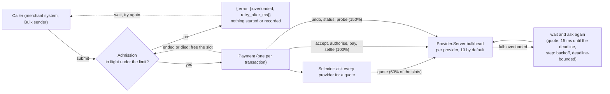

# 10 · Back-pressure

How the system behaves when more transactions arrive than the providers can serve: it admits what it can
finish, refuses the rest cleanly and early, and protects the calls that protect money. Decision record:
[ADR 0013](../adr/0013-back-pressure.md). Measurements: [LOAD_RESULTS](../quality/LOAD_RESULTS.md).

## The pieces

| Piece | Where | What it does |
|---|---|---|
| Admission control | `Admission` (supervised, before the transaction supervisor) | counts running transactions; refuses beyond `max_in_flight`; frees a slot when the payment ends or dies; counters (admitted, refused, peak) |
| Bulkhead classes | `Provider.Server` | quotes 60%, steps 100%, undo/status/probe 150% of `max_in_flight` |
| Quote wait | `Selector` | a busy provider is asked again every 15 ms until the deadline |
| Step wait | `Payment` | `{:error, :overloaded}` on a step: ask again after the backoff, no attempt used, bounded by the deadline |
| Back-off sender | `Demo.Bulk` | holds a refused transaction and retries after the hint; optional cap on its own in-flight count |

## Configuration

| Setting | Where | Default |
|---|---|---|
| `max_in_flight` | `config :actor_tx_spike, admission: [max_in_flight: N]`; `ACTOR_TX_MAX_IN_FLIGHT` in production; `mix demo --max-in-flight N`; the Bulk send tab's admission panel; `{"action": "admission", "max_in_flight": N or "none"}` | none (production: 100) |
| `retry_after_ms` | same | 100 |
| Bulkhead size and shares | `Provider.Server` options `max_in_flight` (10), `quote_share` (0.6), `reserve_share` (0.5) | as shown |
| Sender cap | Bulk send `max_in_flight` | 0 (none) |

## Why a refused submission is safe

`{:error, {:overloaded, ms}}` is returned before the transaction has started: no provider has been asked, no audit
record written, nothing to undo. The same holds one level down: a provider's `:overloaded` answer means the call was
never made, so asking again cannot repeat an effect. That is why waiting is safe where a timeout (an answer that
may have been lost) is not.

## Observing it

* Bulk send tab: the **admission limit** panel (running, admitted, refused, peak) and, in the progress panel, *throttled*,
  *sender waits* and *why they did not complete*.
* `GET /api/snapshot` has an `admission` object; `mix load` prints a table per limit.
* Provider cards show each provider's in-flight count.

## Not covered

A queue in front of the limit, limits per merchant or region, automatic tuning from observed latency, and a record of
refusals in the audit log. Recovery-resumed transactions bypass admission.
