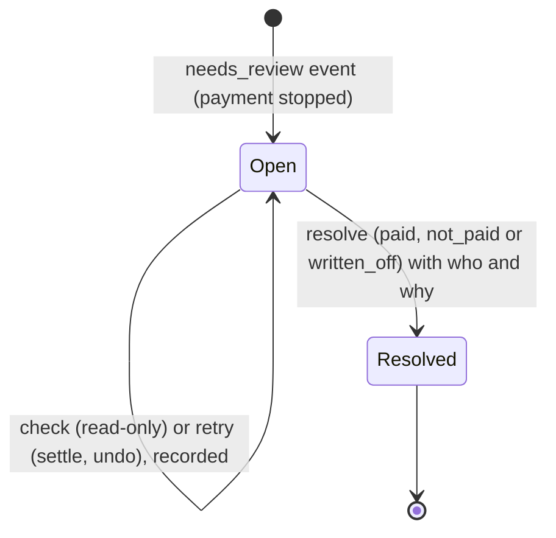
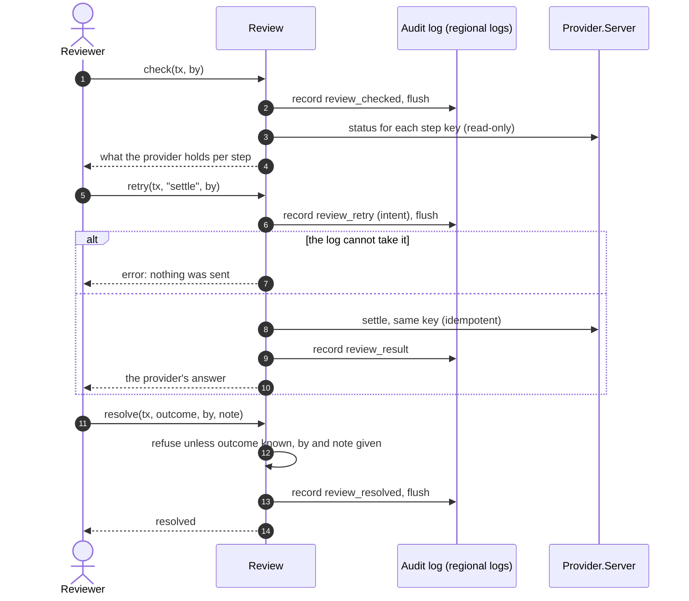

# 11 · Review workflow

What happens to a transaction the system would not settle by guessing, and how a person closes it. Decision record:
[ADR 0014](../adr/0014-product-depth-currencies-review-and-batches.md). Use case: UC-4.

A transaction goes to `needs_review` when a payment could not be confirmed, a settlement or an undo could not be completed, or the
audit log failed after money moved. It never fails over and never guesses; it waits in the queue.

## What a person can do

| Action | Effect on the provider | Recorded | Notes |
|---|---|---|---|
| **Check** | none (status lookup per step key) | `review_checked` with the answers | read-only; use it before deciding |
| **Retry** `settle`, `cancel_accept`, `void_authorisation`, `refund` | the step is sent again under its original key, so a repeat cannot repeat the effect | `review_retry` (intent, flushed first), then `review_result` | steps that need a quote (accept, authorise, pay) cannot be retried here |
| **Resolve** `paid` | none | `review_resolved` | the money moved and it is whole |
| **Resolve** `not_paid` | none | `review_resolved` | nothing moved |
| **Resolve** `written_off` | none | `review_resolved` | it cannot be determined; the exposure is accepted |

Every action needs a reviewer's name; a resolution also needs a reason. A resolved review accepts no more actions.

## Where it lives in the log

Review records belong to the transaction, so they go to the **same regional logs** it was routed to (an India transaction's review
stays in the IN log). The audit router normally forgets a transaction after its costing; for one that went to review it keeps the
routing until the resolution is recorded, and rebuilds that from the logs after a restart.

| Record kind | Data |
|---|---|
| `review_checked` | `by`, `answers` (op, key, the provider's answer) |
| `review_retry` | `by`, `op`, `key` |
| `review_result` | `by`, `op`, `key`, `result` |
| `review_resolved` | `by`, `outcome`, `note` |

## Rebuilding and checking

* `Review.Queue` is pure: entries are built from a live transaction or from audit-log records, so `Review.load/1` restores the queue
  after a restart (`mix demo --audit-dir` does this) and `mix replay reviews LOG` prints it from a log alone.
* The replay rule **`review_recorded`** fails a resolution with no outcome, name or reason, or one recorded for a transaction that never
  went to review.

## On the dashboard

The **Review** tab (badge shows how many are open): the queue on the left; on the right the reason, provider, steps done, the
transaction's story, the trail of what people did, and the controls: your name (remembered in the browser), *Check with the provider*,
*Send again* (settle or an undo), and *Resolve* with an outcome and a note.

## Not built

Four-eyes approval, assignment and teams, deadlines on open reviews, economics adjustments for a manual resolution, retrying steps that
need a quote, and notifying anyone (the badge and the queue are the only signal).
