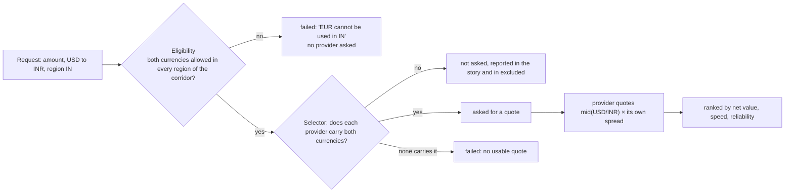

# 12 · Currencies: pricing, provider capability and eligibility

A request names a `source_currency` and a `destination_currency`. They now decide what it costs, who is asked and where it may go.
Decision record: [ADR 0014](../adr/0014-product-depth-currencies-review-and-batches.md).

## The three rules

| Rule | Where | Detail |
|---|---|---|
| **Eligibility** | `Eligibility` rule field `currencies` (`"all"`, or a list of codes) | both currencies must be listed in every region of the corridor (strictest wins). The demo: IN allows INR, USD, EUR, GBP; CN allows CNY, USD, EUR. Reasons name the currency and the region ("INR cannot be used in CN") and are recorded in the decision |
| **Capability** | the provider registry entry's `currencies` (a list; none means all) | a provider that does not carry both is not asked; `Selector` reports `{provider, {:unsupported, "USD/INR"}}` in `excluded` and the story says "not calling X: it does not carry USD to INR" |
| **Pricing** | `Provider.Fake` settings `pair_mids` and `ref_rate` | quoted rate = `mid × rate / ref_rate`: the market rate of the pair carried through the provider's own spread. A repricing, drift or heal changes `rate`, so every pair moves. No currencies, or an unknown pair: the plain `rate` |

## The demo's market

Mid rates (US dollars per unit) and which providers carry what:

| Currency | USD per unit | | Provider | Carries |
|---|---|---|---|---|
| USD | 1.0 | | northwind | USD EUR GBP INR |
| EUR | 1.08 | | bluebird | USD EUR GBP JPY KRW MXN BRL |
| GBP | 1.27 | | cobalt | USD EUR GBP INR SAR TRY MXN BRL |
| INR | 0.012 | | meridian | CNY USD EUR JPY KRW |
| CNY | 0.138 | | zenith | USD EUR GBP CNY JPY |
| MXN | 0.055 | | | |
| BRL | 0.19 | | | |
| TRY | 0.029 | | | |
| SAR | 0.267 | | | |
| JPY | 0.0067 | | | |
| KRW | 0.00073 | | | |

So USD to INR quotes near 83 (carried by northwind and cobalt), USD to SAR only through cobalt, and TRY to KRW has no provider.
The provider cards on the Live tab show what each carries.

## Limits

All currencies are treated as having two decimal places (JPY and KRW have none in reality); fees are in the destination currency's
minor units without conversion; no balances or cross-currency fee schedules; the price list is fixed data. A region can allow a
currency that no eligible provider carries; that ends in "no provider could give a usable quote".
