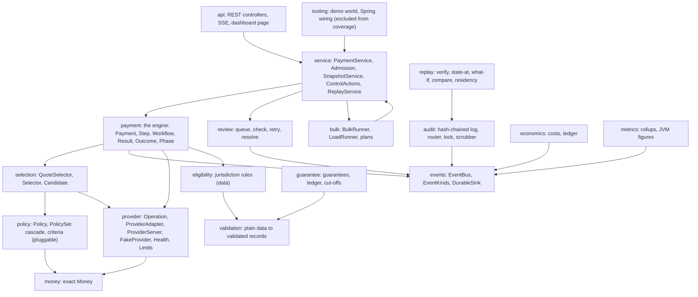
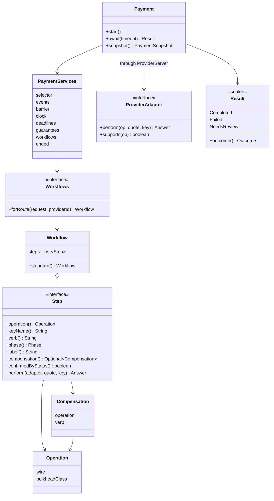
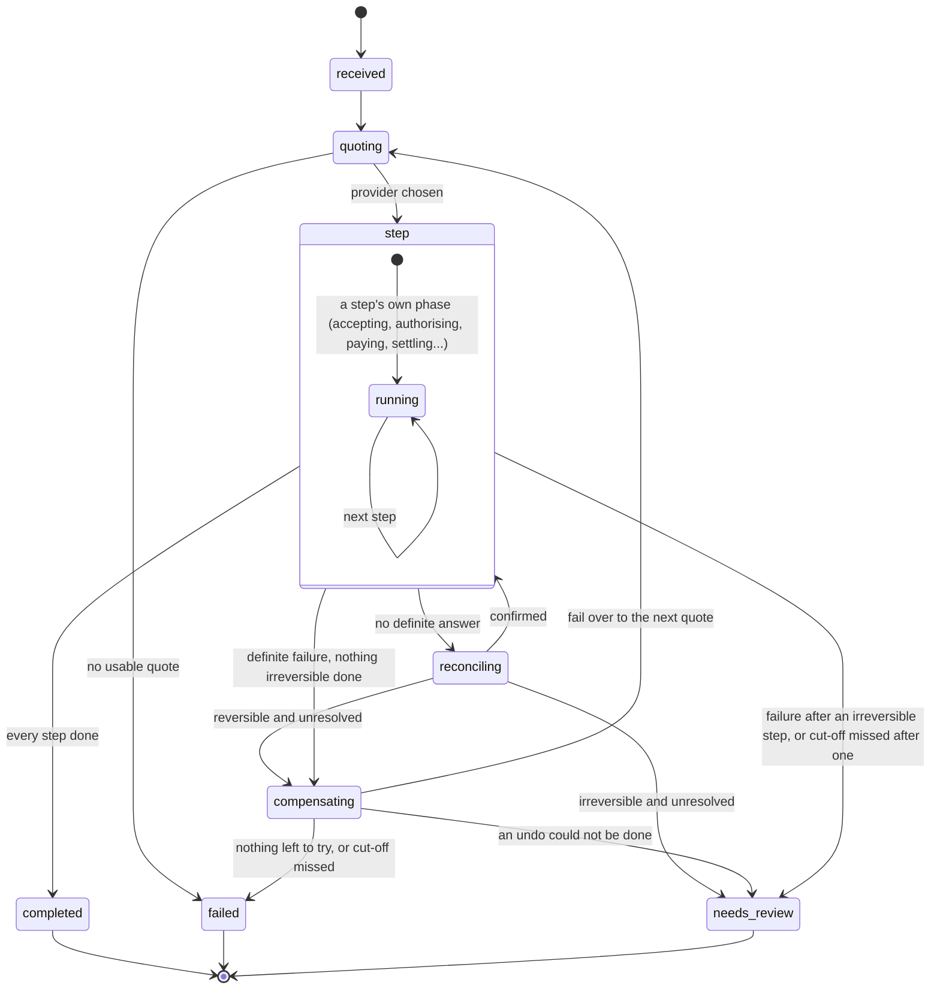
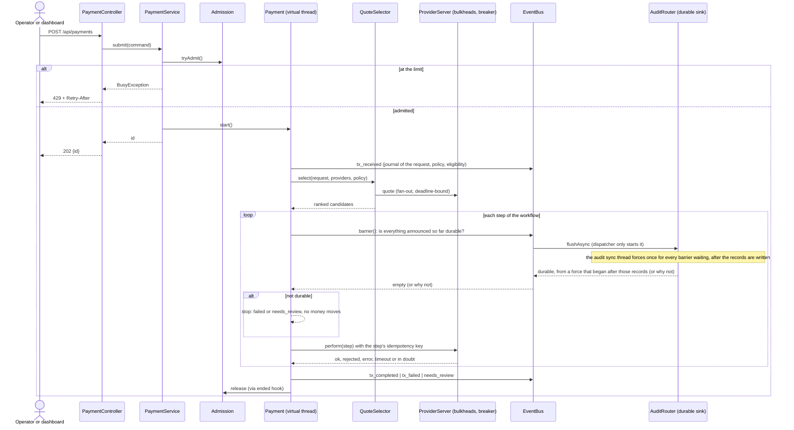

# 13. The Java and Spring build: structure, extension points and mapping

The Java 21 / Spring Boot 3 build in [`java/`](../../java/README.md) is the same system as the Elixir one (orchestrated FX swap and idempotent payment across unreliable providers), converted in chunks ([ADR 0015](../adr/0015-java-spring-port.md)) and then reshaped so the domain can change without editing the engine ([ADR 0016](../adr/0016-extensible-domain-model.md)). The Elixir implementation remains the reference. This page is the structure of the Java build; the use cases, domain model and sequence diagrams in 01 to 12 apply to both.

## 1. Packages

One Maven module, one package per concept, `net.robbrown.actortx.*`. An arrow means "depends on".

## 2. The payment engine

A payment is a **workflow of steps** run by one engine. The engine knows nothing about any particular step.

What a step declares is what the engine's safety rules are derived from:

| A step declares | The engine does |
|---|---|
| **No compensation** (cannot be undone) | once it is done, never fails over to another provider; a later failure or a missed cut-off goes to a person (`needs_review`) |
| **A compensation** | on a definite failure, undoes it (latest first) and fails over; on doubt it cancels by key |
| **Confirmed by status** (asynchronous) | after the provider accepts, asks for its status until confirmed; unresolved after the bounded attempts, an irreversible step goes to a person |
| Its own **operation, key name, verb, phase, label** | uses them in idempotency keys (`<tx>:<provider>:<keyName>`), the story, the phase shown, and reasons (`<label>_failed`, `<label>_overdue`) |

A provider that cannot do every operation of a route's workflow (including the compensations) is passed over with an `unsupported_step` event.

### Phases of one transaction

`audit_unavailable` (the write-ahead barrier says the durable log cannot take the record) ends a transaction as `failed` if nothing was done, and as `needs_review` if anything was.

## 3. A payment over HTTP

Everything the engine does is announced on the `EventBus`, which fans out to: the audit router (durable, hash-chained, regional), the review queue, the economics recorder, the metrics roll-ups, and the dashboard's server-sent events.

## 4. Threads and back-pressure

* One **virtual thread per payment**; one dispatcher thread for the bus (so sinks and subscribers are touched from one thread); one **audit sync thread** per open audit log (the only thread that forces the disk: see section 4.1); one virtual thread per provider call (so a hung provider never blocks its caller).
* **Admission** limits transactions in flight (429 beyond it); each provider has **bulkheads** by priority class (quotes 60%, steps 100%, protective calls 150% of its slots) so undo and status calls still get through when it is saturated; a busy provider is waited for, not failed, and does not use an attempt.
* The write-ahead **barrier** is a synchronisation point with the bus, not a lock: it waits for what was announced before it.

### 4.1 Audit barrier and group commit

The audit log writes each record to the file as the dispatcher delivers it, in order, and does not force it there. The barrier is the only thing that waits for the disk:

1. A payment asks the bus for a barrier. The dispatcher, which has already written every event announced before the call, starts the flush of each sink and goes straight on to the events behind it. It does not wait for the disk.
2. Each audit log records how many records it holds (its target). The barrier's future completes only when a force has **started after** that count was reached and has **returned successfully**.
3. The audit sync thread forces the disk once for everything written so far. Barriers that arrive while a force runs wait for the next one, so one force covers many payments' records (group commit). With no barrier waiting, written records are forced within 50 ms.
4. If a force fails, every barrier waiting on it fails with the same reason as before (`audit_unavailable` at the payment), the log refuses writes from then on, and every later barrier reports the same failure. Nothing acknowledges before it is durable.

Records per force and forces per payment are counted in `AuditStats` and shown on `/api/metrics` as `audit` (`records`, `syncs`, `synced_records`, `records_per_sync`); the router logs the same figures when it closes. ADR [0018](../adr/0018-audit-group-commit.md) has the reasoning and the measurements are in [Performance Analysis/java-group-commit.md](../../Performance%20Analysis/java-group-commit.md).

## 5. Extension points: how to change the domain

| To... | Write | Touch the engine? |
|---|---|---|
| Add a step (screening, hedge, pre-funding) | A `Step` (declare operation, key name, verb, phase, label, compensation); put it in a `Workflow`. See `Steps.reversible(...)` | No |
| Give a corridor or provider its own workflow | A `Workflows` function (`PaymentServices.withWorkflows(...)`) | No |
| Make a step asynchronous | Declare it `confirmedByStatus` | No |
| Add a provider capability | `ProviderAdapter.perform` / `supports` for the new operation | No |
| Add a routing criterion | One class implementing `Criterion`, one line in `Criteria.standard()`; weights are keyed by name | No |
| Add a provider | A `ProviderAdapter`; register it in the catalog | No |
| Change jurisdiction rules | Data: `resources/demo/eligibility.json` | No |
| Add an event kind | A constant in `EventKinds`; readers (replay, review, metrics) match on it | No |
| Change the shape of `tx_received` | Bump `EventKinds.SCHEMA_VERSION`; replay must read both | A replay change |

The tests that prove these without touching the engine are `WorkflowTest` and `SelectorCriteriaTest`. **Where the design is still closed** (and should be reviewed when the domain changes; see the roadmap): `Outcome`, `Breaker`, `HealthState`, `Instrument`, `CustomerType`, `BulkheadClass`, the review status, and `Mode.Kind`. The review service still lists the standard steps itself, and replay rebuilds only the three standard weights from a recorded policy.

## 6. Compatibility with the Elixir build

| Aspect | Same? |
|---|---|
| Audit record envelope and hash chain | Same format: sorted-key JSON, one record per line, `prev`/`hash` chain. Java logs are verified by Java replay; **cross-verification with the Elixir verifier has not been tested** (float and escaping differences are possible) |
| `tx_received` data | Same keys, plus `schema: 1`; the eligibility decision uses the key `permitted?` as the Elixir journal does |
| JSON API and dashboard | The same `priv/panel.html` is served; snake_case JSON; the Performance tab switches to JVM panels when a sample carries `jvm` figures |
| Event kinds and idempotency keys (`<tx>:<provider>:<step>`) | Same |
| Money | Same rules (integer minor units, rates scaled 10^8, half-even) |

## 7. Mapping from the Elixir implementation

| Elixir (OTP) | Java |
|---|---|
| `Payment` GenServer per transaction | `Payment`: one virtual thread per transaction, a `CompletableFuture` for the result |
| Supervision tree, restart | Explicit lifecycle (`@Bean(destroyMethod=...)`); **recovery after restart is not ported yet** |
| `Events` GenServer + subscribers | `EventBus` with a dispatcher thread, history ring, durable sinks, barrier |
| `Audit`, `Audit.Router` | `AuditLog`, `AuditRouter`, `AuditLock` (pid file lock, atomic publish) |
| `Provider.Server` with slots | `ProviderServer` with bulkhead classes, breaker, per-call virtual thread |
| `Selector` (pure), `Selector` fan-out | `Selector` (pure), `QuoteSelector` |
| `Demo`, `Demo.Handler` | `DemoWorld`, `ControlAction` beans, `DashboardController` |
| `Replay.*` | `replay.*` (records are `Map<String,Object>`, tolerant readers) |
| `mix replay`, `mix load`, `mix audit.verify` | **CLI tools not ported yet**; the same functions are reachable over HTTP (`/api/replay`) and as classes (`LoadRunner`) |

## 8. Not yet in the Java build

Recovery after restart; the CLI tools; the dashboard controls **Auto**, **Pace**, **Policy** and the **Test lab** (they answer "not available in the Java port yet"); the Elixir BEAM-specific performance figures (replaced by JVM figures); durable storage beyond the audit log; authentication.
